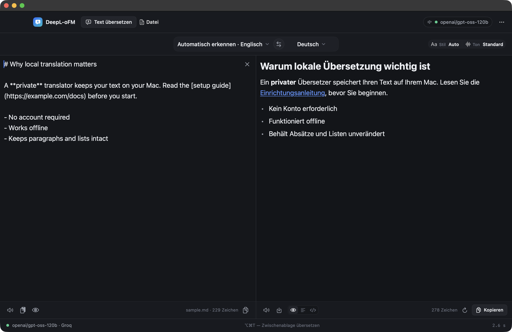
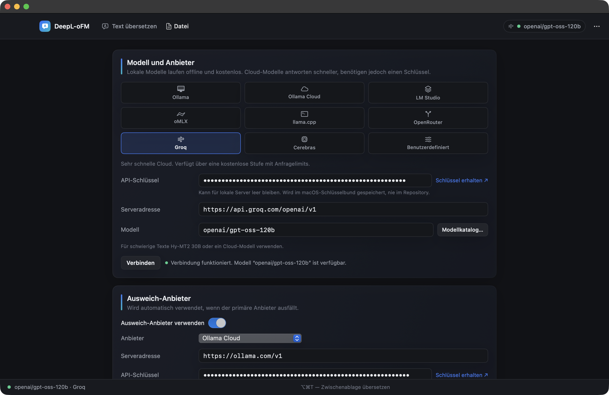

  

<h1 align="center">DeepL-oFM</h1>

  <b>Ein nativer macOS-Übersetzer für lokale und Cloud-Modelle. Behält Absätze, Listen und Markdown bei. Hy-MT2 7B offline über Ollama oder OpenRouter, Groq und Cerebras mit eigenem Schlüssel. Kostenlos, privat und für macOS signiert.</b>

  <a href="README.md">English</a> · <a href="README.uk.md">Українська</a> · <a href="README.ru.md">Русский</a> · <b>Deutsch</b> · <a href="README.fr.md">Français</a> · <a href="README.es.md">Español</a> · <a href="README.pl.md">Polski</a> · <a href="README.pt.md">Português</a> · <a href="README.it.md">Italiano</a>

  
  
  
  

  <a href="https://github.com/Lexus2016/deepl-on-free-models/releases/latest"><b>⬇ DeepL-oFM für macOS laden</b></a>
  · <a href="https://lexus2016.github.io/deepl-on-free-models/">Website</a>

Nicht mit DeepL SE verbunden. „DeepL-oFM“ beschreibt den Oberflächenstil („on Free Models“).

  

## Warum DeepL-oFM

Die meisten Übersetzer sind zuerst eine Website. DeepL-oFM ist zuerst eine native Mac-App: lokale Modelle standardmäßig, Formatierung bleibt erhalten, kein Konto und keine Telemetrie. Dasselbe Fenster kann ein Cloud-Modell nutzen, wenn mehr Tempo oder Qualität nötig sind.

## Funktionen

- Zwei Bereiche mit Fortschrittsanzeige. Der fertige Text erscheint erst, wenn jede Zeile geprüft wurde — kein Teiltext, kein doppelter Müll.
- Automatische Übersetzung beim Tippen (einstellbare Verzögerung).
- Zwei globale Tastenkürzel: **⌥⌘T** — Zwischenablage übersetzen; **⌥⌘C** — markierten Text in jeder App kopieren, DeepL-oFM öffnen und übersetzen.
- 33 Hy-MT2-Sprachen (38 Varianten) mit Sprachsuche.
- Stile **Auto / Wörtlich / Natürlich** und Töne **Standard / Formell / Locker**.
- Modellkatalog, **Verbinden**-Button, Modellliste und Namensfilter.
- Sichtbare **Kopieren**-Schaltfläche: Markdown, HTML und RTF auf einmal.
- **Formatbewusstes Einfügen**: HTML/RTF aus Browser oder Textverarbeitung wird zu Markdown — Überschriften, Listen, Links und Hervorhebungen bleiben.
- **Markdown-Ansicht**: gerendert, nur Text oder Quelltext; Kopieren folgt der aktiven Ansicht.
- Öffne oder ziehe TXT-, Markdown-, PDF- und Word-Dateien in den Bereich „Dateien“. Speichere die Übersetzung im selben Format. Gescannte PDFs brauchen zuerst eine Texterkennung.
- **DOCX** wird direkt aktualisiert (nur `word/document.xml`), **PDF** behält Seiten, Layout, Bilder und Typografie.
- **Neun Oberflächensprachen**: Englisch, Ukrainisch, Russisch, Deutsch, Französisch, Spanisch, Polnisch, Portugiesisch, Italienisch.
- Automatische Updates über **Sparkle 2** mit signiertem Feed.
- Optionaler Ausweich-Anbieter, Vorladen beim Start, Verlauf, Sprachausgabe und Menüleisten-Symbol; das Dock-Symbol lässt sich ausblenden.

## Screenshots

| | |
|---|---|
|  |  |
| **Übersetzung: Fortschritt, fertiger Text, sichtbare Kopieren-Schaltfläche** | **Einstellungen: Anbieter, Modellliste, Ausweich-Anbieter** |

## Sprachen

Die Übersetzungsliste enthält **38 Varianten von 33 Sprachen** (Namen folgen der Oberflächensprache):

Chinese, English, French, Portuguese, Spanish, Japanese, Turkish, Russian, Arabic, Korean, Thai, Italian, German, Vietnamese, Malay, Indonesian, Filipino, Hindi, Traditional Chinese, Polish, Czech, Dutch, Khmer, Burmese, Persian, Gujarati, Urdu, Telugu, Marathi, Hebrew, Bengali, Tamil, Ukrainian, Tibetan, Kazakh, Mongolian, Uyghur, Cantonese.

## Dateien

- **Text und Markdown** behalten Inhalt und Zeilenstruktur.
- **DOCX** behält das Originalpaket: nur `word/document.xml` wird ersetzt, Stile, Bilder, Tabellen, Kopfzeilen und Schriften bleiben unangetastet.
- **PDF** behält die Originalseiten — Layout, Bilder, Grafiken und Typografie — und malt die Übersetzung in dieselben Textblöcke. Gescannte PDFs brauchen zuerst OCR.

## Installation

1. Laden Sie `DeepL-oFM.dmg` von der neuesten Version herunter.
2. Öffnen Sie die DMG und ziehen Sie DeepL-oFM in den Ordner **Programme**.
3. Starten Sie die App. Die DMG ist signiert und notarisiert; frühere Versionen erhalten Updates über Sparkle.

## Weitere Dokumentation

Die vollständige Dokumentation (Anbieter, Modelle, Build) steht in der [englischen README](README.md).

## License

MIT — siehe [LICENSE](LICENSE).
