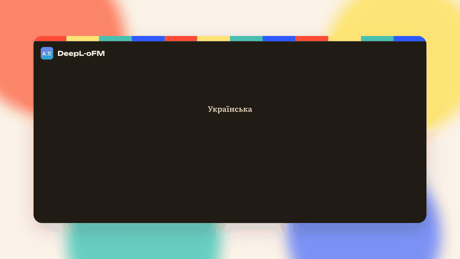
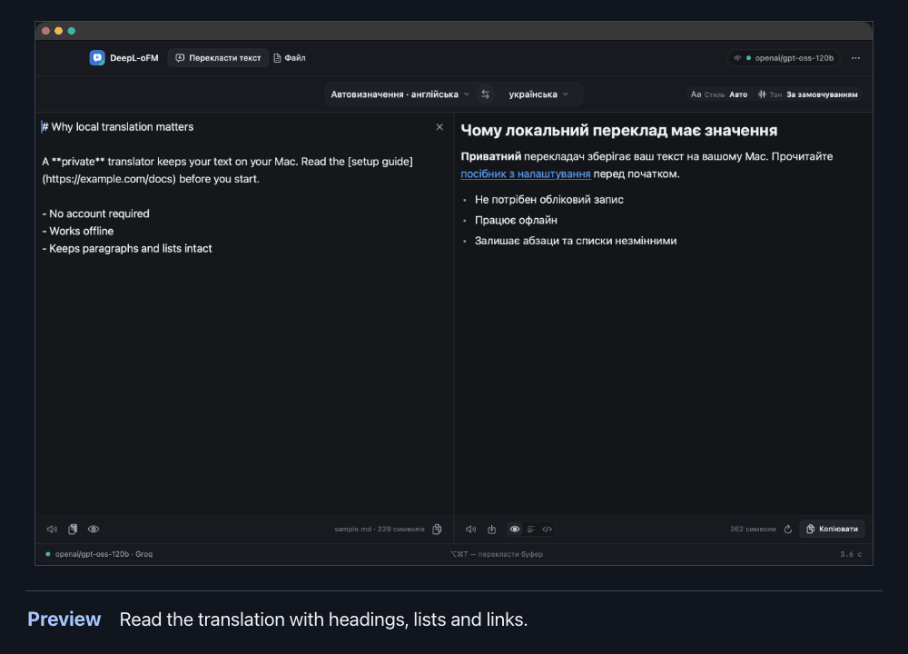
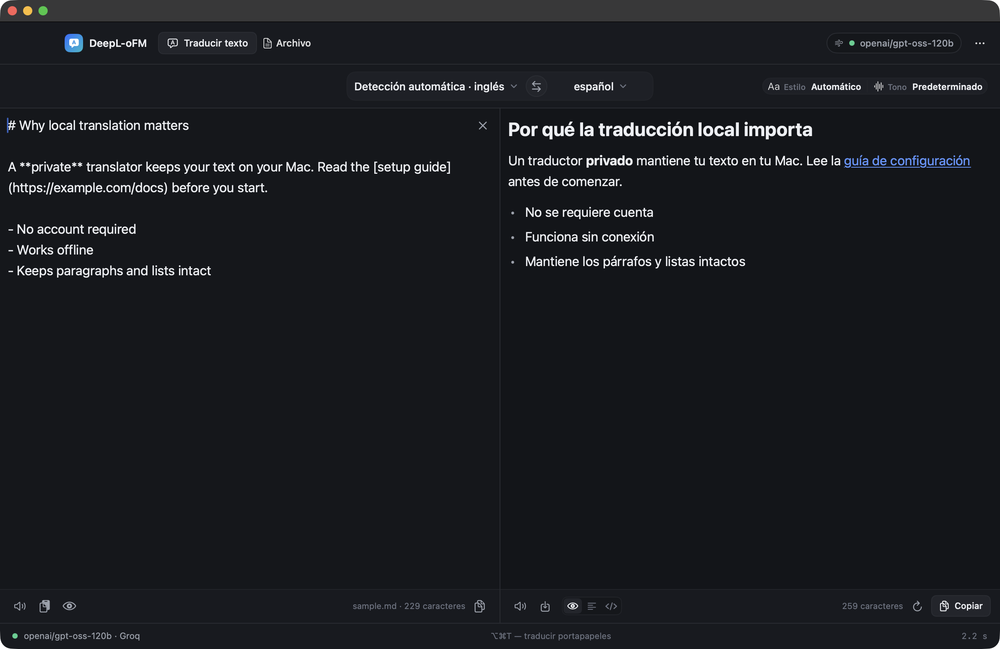
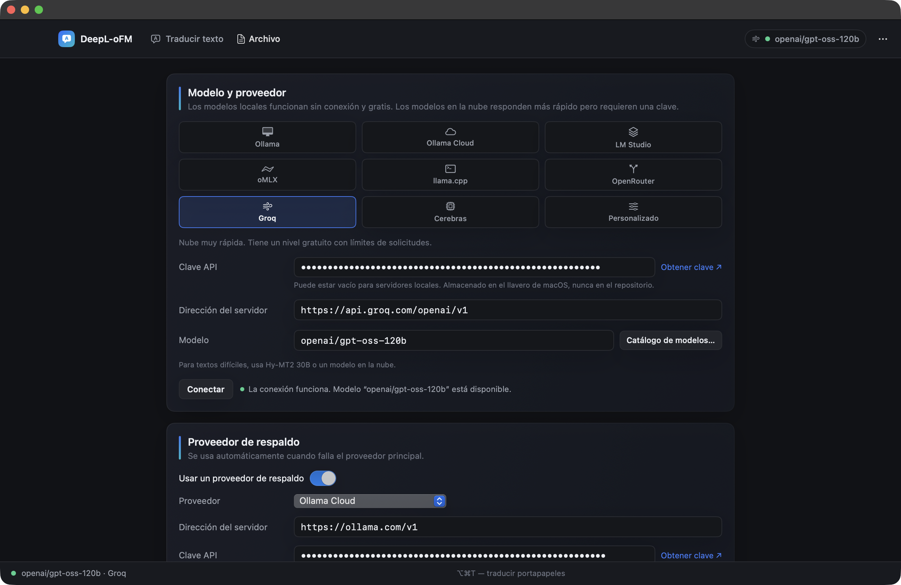

  

<h1 align="center">DeepL-oFM</h1>

  <b>Tu texto puede quedarse en el Mac.</b> 
  Una ventana nativa: Hy-MT2 7B sin conexión con Ollama, u OpenRouter, Groq y
  Cerebras con tu clave. Párrafos, listas y Markdown se quedan. Gratis, privado
  y firmado para macOS.

  <a href="README.md">English</a> · <a href="README.uk.md">Українська</a> · <a href="README.ru.md">Русский</a> · <a href="README.de.md">Deutsch</a> · <a href="README.fr.md">Français</a> · <b>Español</b> · <a href="README.pl.md">Polski</a> · <a href="README.pt.md">Português</a> · <a href="README.it.md">Italiano</a>

  
  
  
  

  <a href="https://github.com/Lexus2016/deepl-on-free-models/releases/latest"><b>⬇ Descargar DeepL-oFM para macOS</b></a>
  · <a href="https://lexus2016.github.io/deepl-on-free-models/">Sitio web</a>

No afiliado a DeepL SE. «DeepL-oFM» describe el estilo de la interfaz («on Free Models»).

  

  

## Por qué DeepL-oFM

La mayoría de los traductores son primero una web. DeepL-oFM es primero una app nativa de Mac: modelos locales por defecto, formato conservado, sin cuenta y sin telemetría. La misma ventana puede usar un modelo en la nube cuando necesitas más velocidad o calidad.

## Funciones

- Traducción en dos paneles con indicador de progreso. El texto final aparece solo cuando se ha comprobado cada línea, sin texto parcial ni duplicados.
- Traducción automática mientras escribes (retardo configurable).
- Dos atajos globales: **⌥⌘T** — traducir el portapapeles; **⌥⌘C** — copiar el texto seleccionado en cualquier app, abrir DeepL-oFM y traducirlo.
- 33 idiomas Hy-MT2 (38 variantes) con búsqueda.
- Estilos **Auto / Literal / Natural** y tonos **Predeterminado / Formal / Informal**.
- Catálogo de modelos, botón **Conectar**, lista de modelos y filtro por nombre.
- Botón **Copiar** visible: Markdown, HTML y RTF a la vez.
- **Pegado con formato**: HTML/RTF del navegador o del procesador de textos se convierte en Markdown; títulos, listas, enlaces y énfasis se conservan.
- **Vista Markdown**: renderizada, solo texto o código fuente; Copiar sigue la vista activa.
- Abre o arrastra archivos TXT, Markdown, PDF y Word a la pestaña Archivos. Guarda la traducción en el mismo formato. Si el PDF es un escaneo, usa primero el reconocimiento de texto.
- **DOCX** se actualiza en el sitio (solo `word/document.xml`); **PDF** conserva las páginas, el diseño, las imágenes y la tipografía.
- **Nueve idiomas de interfaz**: inglés, ucraniano, ruso, alemán, francés, español, polaco, portugués, italiano.
- Actualizaciones automáticas con **Sparkle 2** y un canal firmado.
- Proveedor de respaldo, precarga al iniciar, historial, voz del sistema e icono en la barra de menús; el icono del Dock se puede ocultar.

## Capturas

| | |
|---|---|
|  |  |
| **Traducción: progreso, texto final, botón Copiar visible** | **Ajustes: proveedores, lista de modelos, respaldo** |

## Idiomas

La lista de traducción contiene **38 variantes de 33 idiomas** (los nombres siguen el idioma de la interfaz):

Chinese, English, French, Portuguese, Spanish, Japanese, Turkish, Russian, Arabic, Korean, Thai, Italian, German, Vietnamese, Malay, Indonesian, Filipino, Hindi, Traditional Chinese, Polish, Czech, Dutch, Khmer, Burmese, Persian, Gujarati, Urdu, Telugu, Marathi, Hebrew, Bengali, Tamil, Ukrainian, Tibetan, Kazakh, Mongolian, Uyghur, Cantonese.

## Archivos

- **Texto y Markdown** conservan el contenido y la estructura de líneas.
- **DOCX** conserva el paquete original: solo se sustituye `word/document.xml`; estilos, imágenes, tablas, encabezados y fuentes quedan intactos.
- **PDF** conserva las páginas originales —diseño, imágenes, gráficos y tipografía— y pinta la traducción en los mismos bloques de texto. Los PDF escaneados necesitan OCR.

## Instalación

1. Descarga `DeepL-oFM.dmg` de la última versión.
2. Abre la DMG y arrastra DeepL-oFM a **Aplicaciones**.
3. Inicia la app. La DMG está firmada y notarizada; las versiones anteriores reciben la actualización por Sparkle.

## Documentación completa

La documentación completa (proveedores, modelos, compilación) está en el [README en inglés](README.md).

## License

MIT — consulta [LICENSE](LICENSE).
