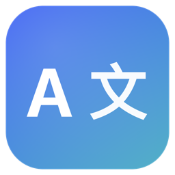
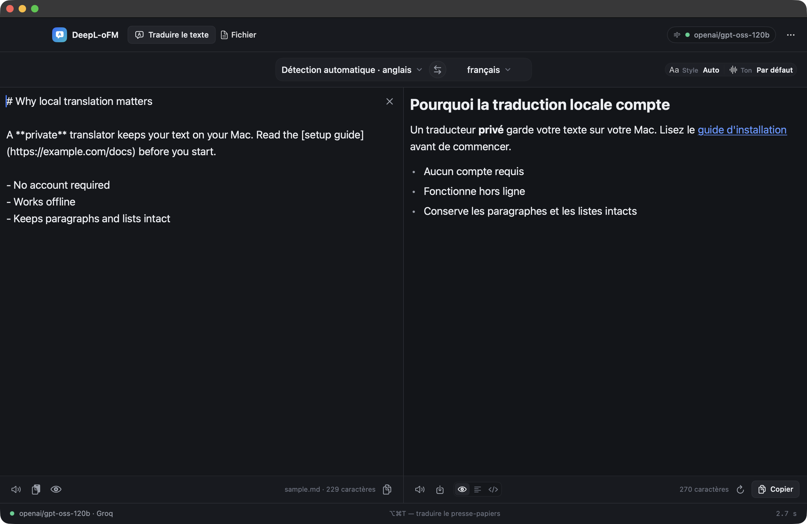
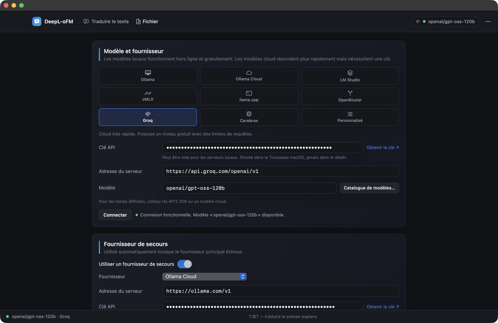

  

<h1 align="center">DeepL-oFM</h1>

  <b>Un traducteur macOS natif pour les modèles locaux et cloud. Conserve les paragraphes, les listes et le Markdown. Hy-MT2 7B hors ligne via Ollama, ou OpenRouter, Groq et Cerebras avec votre clé. Gratuit, privé et signé pour macOS.</b>

  <a href="README.md">English</a> · <a href="README.uk.md">Українська</a> · <a href="README.ru.md">Русский</a> · <a href="README.de.md">Deutsch</a> · <b>Français</b> · <a href="README.es.md">Español</a> · <a href="README.pl.md">Polski</a> · <a href="README.pt.md">Português</a> · <a href="README.it.md">Italiano</a>

  
  
  
  

  <a href="https://github.com/Lexus2016/deepl-on-free-models/releases/latest"><b>⬇ Télécharger DeepL-oFM pour macOS</b></a>
  · <a href="https://lexus2016.github.io/deepl-on-free-models/">Site web</a>

Non affilié à DeepL SE. « DeepL-oFM » décrit le style de l'interface (« on Free Models »).

  

## Pourquoi DeepL-oFM

La plupart des traducteurs sont d'abord un site web. DeepL-oFM est d'abord une app Mac native : modèles locaux par défaut, mise en forme conservée, aucun compte et aucune télémétrie. La même fenêtre peut utiliser un modèle cloud quand il faut plus de vitesse ou de qualité.

## Fonctionnalités

- Traduction à deux volets avec indicateur de progression. Le texte final n'apparaît qu'une fois chaque ligne vérifiée — pas de texte partiel ni de doublons.
- Traduction automatique pendant la saisie (délai réglable).
- Deux raccourcis globaux : **⌥⌘T** — traduire le presse-papiers ; **⌥⌘C** — copier le texte sélectionné dans n'importe quelle app, ouvrir DeepL-oFM et le traduire.
- 33 langues Hy-MT2 (38 variantes) avec recherche.
- Styles **Auto / Littéral / Naturel** et tons **Par défaut / Formel / Décontracté**.
- Catalogue de modèles, bouton **Connecter**, liste des modèles et filtre par nom.
- Bouton **Copier** visible : Markdown, HTML et RTF en une fois.
- **Collage respectueux de la mise en forme** : HTML/RTF du navigateur ou du traitement de texte devient du Markdown — titres, listes, liens et emphases conservés.
- **Vue Markdown** : rendu, texte seul ou source ; Copier suit la vue active.
- Ouvrez ou déposez vos fichiers TXT, Markdown, PDF et Word dans l’onglet Fichiers. Enregistrez la traduction au format d’origine. Pour un PDF scanné, lancez d’abord la reconnaissance de texte.
- **DOCX** est mis à jour sur place (seulement `word/document.xml`) ; **PDF** conserve les pages, la mise en page, les images et la typographie.
- **Neuf langues d'interface** : anglais, ukrainien, russe, allemand, français, espagnol, polonais, portugais, italien.
- Mises à jour automatiques via **Sparkle 2** avec un flux signé.
- Fournisseur de secours, préchargement au lancement, historique, synthèse vocale et icône dans la barre des menus ; l'icône du Dock peut être masquée.

## Captures d'écran

| | |
|---|---|
|  |  |
| **Traduction : progression, texte final, bouton Copier visible** | **Réglages : fournisseurs, liste des modèles, secours** |

## Langues

La liste de traduction contient **38 variantes de 33 langues** (les noms suivent la langue de l'interface) :

Chinese, English, French, Portuguese, Spanish, Japanese, Turkish, Russian, Arabic, Korean, Thai, Italian, German, Vietnamese, Malay, Indonesian, Filipino, Hindi, Traditional Chinese, Polish, Czech, Dutch, Khmer, Burmese, Persian, Gujarati, Urdu, Telugu, Marathi, Hebrew, Bengali, Tamil, Ukrainian, Tibetan, Kazakh, Mongolian, Uyghur, Cantonese.

## Fichiers

- **Texte et Markdown** conservent le contenu et la structure des lignes.
- **DOCX** conserve le paquet d'origine : seul `word/document.xml` est remplacé, les styles, images, tableaux, en-têtes et polices restent intacts.
- **PDF** conserve les pages d'origine — mise en page, images, graphiques et typographie — et peint la traduction dans les mêmes blocs de texte. Les PDF scannés nécessitent d'abord une OCR.

## Installation

1. Téléchargez `DeepL-oFM.dmg` depuis la dernière version.
2. Ouvrez la DMG et glissez DeepL-oFM dans **Applications**.
3. Lancez l'app. La DMG est signée et notariée ; les versions précédentes reçoivent les mises à jour via Sparkle.

## Documentation complète

La documentation complète (fournisseurs, modèles, compilation) se trouve dans le [README anglais](README.md).

## License

MIT — voir [LICENSE](LICENSE).
