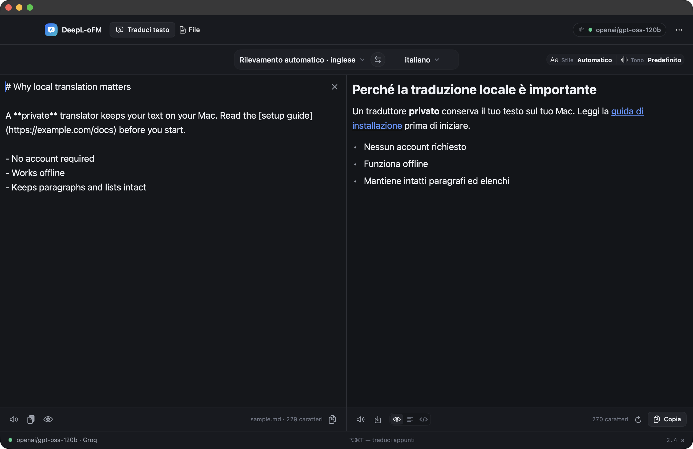
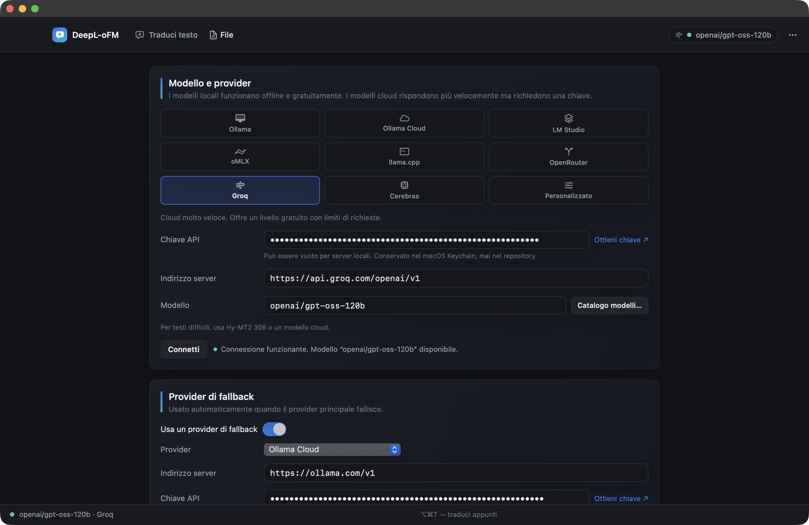

  

<h1 align="center">DeepL-oFM</h1>

  <b>Un traduttore macOS nativo per modelli locali e cloud. Mantiene paragrafi, elenchi e Markdown. Hy-MT2 7B offline con Ollama, oppure OpenRouter, Groq e Cerebras con la tua chiave. Gratuito, privato e firmato per macOS.</b>

  <a href="README.md">English</a> · <a href="README.uk.md">Українська</a> · <a href="README.ru.md">Русский</a> · <a href="README.de.md">Deutsch</a> · <a href="README.fr.md">Français</a> · <a href="README.es.md">Español</a> · <a href="README.pl.md">Polski</a> · <a href="README.pt.md">Português</a> · <b>Italiano</b>

  
  
  
  

  <a href="https://github.com/Lexus2016/deepl-on-free-models/releases/latest"><b>⬇ Scarica DeepL-oFM per macOS</b></a>
  · <a href="https://lexus2016.github.io/deepl-on-free-models/">Sito</a>

Non affiliato a DeepL SE. «DeepL-oFM» descrive lo stile dell'interfaccia («on Free Models»).

  

## Perché DeepL-oFM

La maggior parte dei traduttori è prima un sito web. DeepL-oFM è prima un'app Mac nativa: modelli locali per impostazione predefinita, formattazione conservata, nessun account e nessuna telemetria. La stessa finestra può usare un modello cloud quando servono più velocità o qualità.

## Funzionalità

- Traduzione a due pannelli con indicatore di avanzamento. Il testo finale appare solo dopo il controllo di ogni riga — niente testo parziale o duplicati.
- Traduzione automatica mentre digiti (ritardo regolabile).
- Due scorciatoie globali: **⌥⌘T** — traduci gli appunti; **⌥⌘C** — copia il testo selezionato in qualsiasi app, apri DeepL-oFM e traducilo.
- 33 lingue Hy-MT2 (38 varianti) con ricerca.
- Stili **Auto / Letterale / Naturale** e toni **Predefinito / Formale / Informale**.
- Catalogo modelli, pulsante **Connetti**, elenco modelli e filtro per nome.
- Pulsante **Copia** visibile: Markdown, HTML e RTF insieme.
- **Incolla con formattazione**: HTML/RTF dal browser o dall'elaboratore di testi diventa Markdown — titoli, elenchi, link ed enfasi conservati.
- **Vista Markdown**: renderizzata, solo testo o sorgente; Copia segue la vista attiva.
- **File**: `.txt`, `.md`, `.pdf` e `.docx` da aprire o trascinare; salvataggio nel formato originale.
- **DOCX** viene aggiornato sul posto (solo `word/document.xml`); **PDF** conserva pagine, layout, immagini e tipografia.
- **Nove lingue dell'interfaccia**: inglese, ucraino, russo, tedesco, francese, spagnolo, polacco, portoghese, italiano.
- Aggiornamenti automatici con **Sparkle 2** e canale firmato.
- Provider di riserva, precaricamento all'avvio, cronologia, voce di sistema e icona nella barra dei menu; l'icona nel Dock può essere nascosta.

## Schermate

| | |
|---|---|
|  |  |
| **Traduzione: avanzamento, testo finale, pulsante Copia visibile** | **Impostazioni: provider, elenco modelli, riserva** |

## Lingue

L'elenco di traduzione contiene **38 varianti di 33 lingue** (i nomi seguono la lingua dell'interfaccia):

Chinese, English, French, Portuguese, Spanish, Japanese, Turkish, Russian, Arabic, Korean, Thai, Italian, German, Vietnamese, Malay, Indonesian, Filipino, Hindi, Traditional Chinese, Polish, Czech, Dutch, Khmer, Burmese, Persian, Gujarati, Urdu, Telugu, Marathi, Hebrew, Bengali, Tamil, Ukrainian, Tibetan, Kazakh, Mongolian, Uyghur, Cantonese.

## File

- **Testo e Markdown** conservano contenuto e struttura delle righe.
- **DOCX** conserva il pacchetto originale: viene sostituito solo `word/document.xml`, quindi stili, immagini, tabelle, intestazioni e font restano intatti.
- **PDF** conserva le pagine originali — layout, immagini, grafici e tipografia — e disegna la traduzione negli stessi blocchi di testo. I PDF scansionati richiedono prima l'OCR.

## Installazione

1. Scarica `DeepL-oFM.dmg` dall'ultima versione.
2. Apri il DMG e trascina DeepL-oFM in **Applicazioni**.
3. Avvia l'app. Il DMG è firmato e notarizzato; le versioni precedenti ricevono l'aggiornamento tramite Sparkle.

## Documentazione completa

La documentazione completa (provider, modelli, compilazione) è nel [README inglese](README.md).

## License

MIT — vedi [LICENSE](LICENSE).
