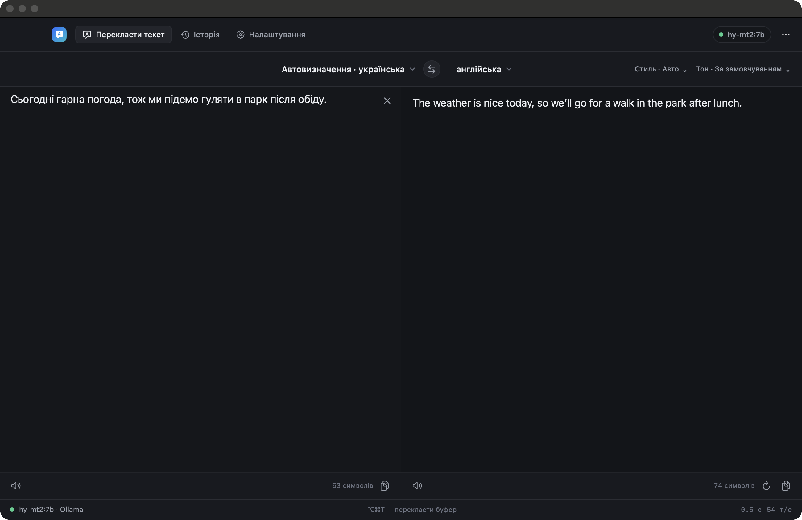
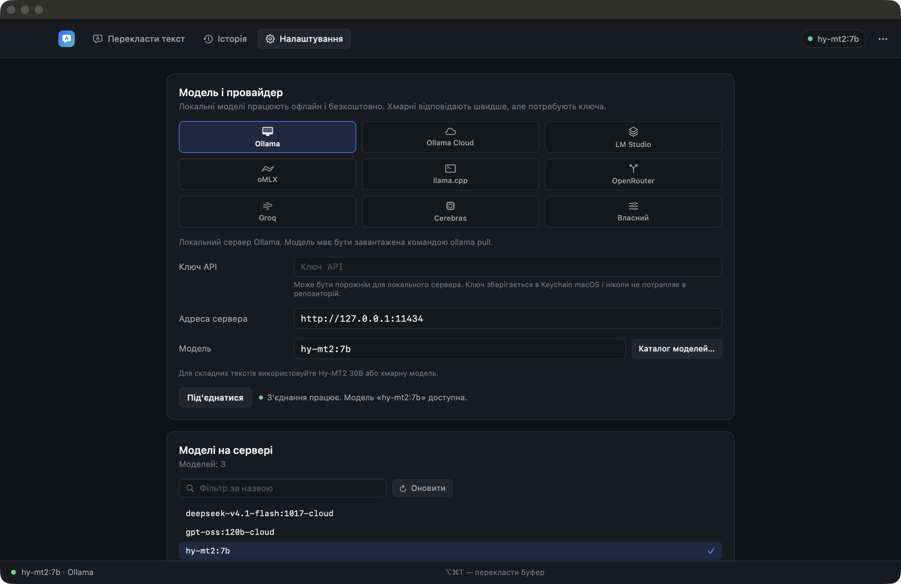

# HyMT — аналог DeepL на локальних і безкоштовних моделях

> **HyMT** — a native macOS DeepL alternative for local and free translation models.
> Interface in Ukrainian, Russian and English.

[](https://github.com/Lexus2016/deepl-on-free-models/releases)
[](LICENSE)


Нативний застосунок для macOS у стилі DeepL: дві панелі, автоматичний переклад під
час введення, історія, гарячі клавіші та локальна модель **Hy-MT2 7B** (Tencent Hy).
Працює офлайн, але вміє й хмарні моделі — OpenRouter, Groq, Cerebras, Ollama Cloud.

**Репозиторій:** https://github.com/Lexus2016/deepl-on-free-models





## Можливості

- Двопанельний переклад із потоковим виводом, як у DeepL.
- Автоматичний переклад під час введення (затримка налаштовується).
- Дві глобальні гарячі клавіші:
  - **⌥⌘T** — перекласти вміст буфера обміну;
  - **⌥⌘C** — скопіювати **виділений текст** у будь-якому застосунку, відкрити
    HyMT і одразу перекласти його.
- 33 мови Hy-MT2 (38 варіантів у списку), пошук мови.
- Стилі **Авто / Дослівний / Природний** і тони **За замовчуванням / Офіційний /
  Розмовний** — точно за карткою моделі.
- Каталог моделей, кнопка **«Під'єднатися»**, отримання списку моделей із сервера
  та фільтр за частиною назви.
- Локальні провайдери: Ollama, LM Studio, oMLX, llama.cpp.
- Хмарні провайдери: Ollama Cloud, OpenRouter, Groq, Cerebras.
- Будь-який OpenAI-сумісний сервер вручну (vLLM, LocalAI, свій проксі).
- Історія перекладів із пошуком, копіюванням і видаленням.
- Прослуховування оригіналу й перекладу системними голосами macOS.
- Інтерфейс українською, російською та англійською; мова змінюється на льоту.
- Іконка в меню-барі та швидкий переклад звідти.

## Підтримувані провайдери

| Провайдер | Тип | API-ключ | Примітка |
|---|---|---|---|
| Ollama | локально | не потрібен | локальні моделі та `-cloud` моделі через `ollama signin` |
| Ollama Cloud | хмара | потрібен | прямий доступ до `https://ollama.com/v1` |
| LM Studio | локально | зазвичай не потрібен | локальний сервер LM Studio |
| oMLX | локально | зазвичай не потрібен | MLX-сервер для Apple Silicon |
| llama.cpp | локально | зазвичай не потрібен | `llama-server --api` |
| OpenRouter | хмара | потрібен | є безкоштовні моделі з суфіксом `:free` |
| Groq | хмара | потрібен | безкоштовний тариф із лімітами |
| Cerebras | хмара | потрібен | безкоштовний тариф із лімітами |
| Інший | будь-де | за потреби | будь-який OpenAI-сумісний endpoint |

Поле **«Ключ API»** доступне для всіх провайдерів: для локального сервера воно
зазвичай порожнє, але якщо ваш проксі або LM Studio вимагають токен — введіть його.
Ключ зберігається в **Keychain macOS** і ніколи не записується в репозиторій.

## Моделі

### Локально через Ollama

| Модель | Ідентифікатор | Розмір | Мови |
|---|---|---|---|
| Hy-MT2 7B | `hy-mt2:7b` | ≈4,6 ГБ | 33 |
| Hy-MT2 1.8B | `hy-mt2:1.8b` | легка | 33 |
| Hy-MT2 30B-A3B | `hy-mt2:30b` | велика, MoE | 33 |
| TranslateGemma 4B | `translategemma:4b` | ≈3 ГБ | 55 |
| TranslateGemma 12B | `translategemma:12b` | ≈8 ГБ | 55 |
| Qwen3.5-MT 2B | `qwen3.5-mt:2b` | 2B | переклад |
| Aya Expanse 8B | `aya-expanse:8b` | 8B | 23 |
| Qwen3 8B | `qwen3:8b` | 8B | універсальна |

Команди встановлення видно в **Налаштування → Каталог моделей…** (кнопка з
копіюванням). Для Hy-MT2 достатньо:

```bash
ollama pull maternion/hy-mt2:7b
ollama cp maternion/hy-mt2:7b hy-mt2:7b
```

Легша версія:

```bash
ollama pull maternion/hy-mt2:1.8b
ollama cp maternion/hy-mt2:1.8b hy-mt2:1.8b
```

### Ollama Cloud — два режими

1. **Через локальний демон Ollama.** Увійдіть і використовуйте `-cloud` моделі:

   ```bash
   ollama signin
   ollama run gpt-oss:120b-cloud
   ```

   У застосунку оберіть провайдера **Ollama**, натисніть **«Під'єднатися»** — у
   списку з'являться і локальні моделі, і `-cloud` моделі. Ключ у застосунку не
   потрібен: авторизацію виконує демон.

2. **Прямо через Ollama Cloud API.** Оберіть провайдера **Ollama Cloud**, введіть
   ключ із [ollama.com/settings/keys](https://ollama.com/settings/keys). Базова
   адреса — `https://ollama.com/v1`, локальний сервер не потрібен. Список
   доступних хмарних моделей з'явиться після **«Під'єднатися»**.

> Хмарні моделі Ollama тарифікуються за планом і використанням; локальні моделі —
> безкоштовні й не потребують інтернету.

### Хмарні провайдери

**OpenRouter** (ключ: [openrouter.ai/keys](https://openrouter.ai/keys)):

- `tencent/hy-mt2-7b`, `tencent/hy-mt2-1.8b`, `tencent/hy-mt2-30b-a3b` — та сама
  перекладацька модель у хмарі;
- `google/gemma-4-31b-it:free`, `google/gemma-4-26b-a4b-it:free`,
  `nvidia/nemotron-3-ultra-550b-a55b:free`, `inclusionai/ling-3.2-flash:free` —
  безкоштовні моделі з лімітами;
- `google/gemini-3.1-flash-lite`, `qwen/qwen3.7-flash`, `openai/gpt-5-mini` —
  швидкі платні варіанти.

**Groq** (ключ: [console.groq.com/keys](https://console.groq.com/keys)):

- `openai/gpt-oss-120b` — ~500 т/с;
- `openai/gpt-oss-20b` — ~1000 т/с;
- `llama-3.3-70b-versatile` — ~280 т/с;
- `qwen/qwen3.8-27b` — ~450 т/с, preview.

**Cerebras** (ключ: [cloud.cerebras.ai](https://cloud.cerebras.ai)):

- `gpt-oss-120b` — ~3000 т/с;
- `qwen-3.8-27b` — ~1850 т/с.

Списки моделей у хмарних провайдерів змінюються, тому головний шлях — кнопка
**«Під'єднатися»**: застосунок отримує актуальний список із сервера й показує його
з фільтром. Каталог — це лише рекомендовані варіанти.

## Встановлення

Потрібні macOS 14+, Xcode Command Line Tools і [Ollama](https://ollama.com).

```bash
git clone https://github.com/Lexus2016/deepl-on-free-models.git
cd deepl-on-free-models

# 1. Модель + тестовий переклад + збірка
./setup.sh

# або вручну:
ollama pull maternion/hy-mt2:7b
ollama cp maternion/hy-mt2:7b hy-mt2:7b
./build.sh

# 2. Запуск
open build/HyMT.app

# 3. За бажанням — у Applications
cp -R build/HyMT.app /Applications/
open /Applications/HyMT.app
```

Застосунок живе в меню-барі: закриття вікна не вимикає гарячі клавіші. Щоб вони
працювали після перезавантаження, додайте HyMT у **Системні налаштування →
Основні → Елементи входу** (або запускайте застосунок вручну).

## Перше підключення

1. **Налаштування → Модель і провайдер**.
2. Оберіть провайдера. Для локального Ollama адреса вже стоїть:
   `http://127.0.0.1:11434`.
3. Введіть ключ API, якщо він потрібен (для локального сервера — зазвичай ні).
4. Натисніть **«Під'єднатися»**. Застосунок перевірить сервер і покаже список
   моделей.
5. Введіть частину назви у **«Фільтр за назвою»** й оберіть модель.
6. Для рекомендованих моделей відкрийте **«Каталог моделей…»**.

Якщо моделі немає — у картці з'явиться команда `ollama pull …` з кнопкою
копіювання.

## Гарячі клавіші

Типові значення:

| Комбінація | Дія |
|---|---|
| **⌥⌘T** | прочитати буфер обміну, відкрити HyMT і перекласти |
| **⌥⌘C** | скопіювати виділений текст у поточному застосунку, відкрити HyMT і перекласти |

Обидві змінюються в **Налаштування → Гаряча клавіша** (кнопка запису, `Esc` —
скасувати). Потрібен щонайменше один модифікатор — ⌘, ⌥ або ⌃.

Для **⌥⌘C** macOS вимагає дозвіл **Accessibility**: застосунок має право
надіслати `⌘C` активному застосунку, щоб скопіювати виділення. Статус видно в
налаштуваннях; кнопка **«Відкрити системні налаштування»** веде прямо до
**Privacy & Security → Accessibility**. Без дозволу застосунок покаже
повідомлення й не чіпатиме буфер обміну.

Після кожного перезбирання ad-hoc підпис змінюється, тому macOS може попросити
надати Accessibility ще раз. Для постійного підпису використовуйте Developer ID.

## Мова інтерфейсу

**Налаштування → Поведінка → Мова інтерфейсу**: Системна, Українська, Русский,
English. Зміна застосовується одразу, без перезапуску. Промпти до моделі завжди
англійською — це мова інструкцій Hy-MT2.

## Промпти

Hy-MT2 не має системного промпту: інструкція та текст передаються **одним
повідомленням**.

| Стиль | Інструкція |
|---|---|
| Авто | `Translate the following text into {target_language}. Note that you should only output the translated result without any additional explanation:` |
| Дослівний | `Please translate the following text into {target_language}. Note that the translation style must strictly conform to [literal, word for word]:` |
| Природний | `Please translate the following text into {target_language}. Note that the translation style must strictly conform to [natural and idiomatic, conveying the meaning rather than the wording]:` |

Тон додається до опису стилю:

| Тон | Доповнення |
|---|---|
| За замовчуванням | без доповнення |
| Офіційний | `; formal and professional` |
| Розмовний | `; casual and conversational` |

Комбінація «Авто + За замовчуванням» дає базову інструкцію без опису стилю.
Поточний згенерований промпт видно в **Налаштування → Системний промпт**.

## Параметри генерації

Типові значення відповідають рекомендаціям Tencent для Hy-MT2 7B:

```
temperature    = 0.7
top_p          = 0.6
top_k          = 20
repeat_penalty = 1.05
num_ctx        = 8192
```

Усі змінюються в налаштуваннях. Довгі тексти (понад ~3200 символів) діляться на
частини за абзацами або реченнями, перекладаються окремо й склеюються зі
збереженням розривів.

## Безпека та приватність

- **API-ключі** зберігаються в **Keychain macOS**, окремо для кожного провайдера.
  Вони не потрапляють у `UserDefaults`, журнали, історію перекладів або
  репозиторій.
- У репозиторії немає ключів, токенів, `.env`-файлів чи моделей; `.gitignore`
  виключає `.env`, `*.key`, `*.pem`, `*.gguf`, `build/`, `.build/` та логи.
- Локальні моделі (Ollama, LM Studio, oMLX, llama.cpp) не надсилають текст у
  мережу.
- Хмарні провайдери (OpenRouter, Groq, Cerebras, Ollama Cloud) отримують текст
  перекладу — це їхня звичайна робота; обирайте їх свідомо.
- Застосунок не має телеметрії й не збирає статистику.
- Дозвіл Accessibility використовується лише для надсилання `⌘C` перед
  перекладом виділеного тексту.

Якщо ключ випадково потрапив у публічний репозиторій — негайно відкликайте його в
панелі провайдера. Деталі: [SECURITY.md](SECURITY.md).

## Діагностика

- **«Модель не знайдена»** — перевірте `ollama list`; назва в полі «Модель» має
  збігатися з назвою на сервері. Натисніть **«Під'єднатися»**, щоб побачити
  актуальний список.
- **«Сервер недоступний»** — запустіть `ollama serve` або відповідний сервер і
  перевірте адресу.
- **HTTP 401 / 403** — перевірте API-ключ для хмарного провайдера.
- **Гаряча клавіша не працює** — комбінація може бути зайнята; оберіть іншу.
  Статус реєстрації видно під полем запису.
- **⌥⌘C не копіює виділення** — надайте Accessibility у системних налаштуваннях.
- Локальний запуск із журналом:

  ```bash
  HYMT_DEBUG=1 ./build/HyMT.app/Contents/MacOS/HyMT --prefill "Hello world"
  ```

## Архітектура

```
Sources/HyMT/
  HyMTApp.swift              точка входу, меню, AppDelegate
  AppState.swift             стан, дебаунс, історія, гарячі клавіші, моделі
  Models/
    Language.swift           33 мови Hy-MT2, визначення мови, локалізовані назви
    Prompt.swift             стилі, тони, збірка інструкції
    AppSettings.swift        налаштування (UserDefaults) і Keychain-ключі
    Provider.swift           локальні й хмарні провайдери
    ModelCatalog.swift       каталог рекомендованих моделей
    KeyCombo.swift           комбінації клавіш
  Services/
    TranslationService.swift Ollama / OpenAI-сумісний стрімінг, чанкінг
    Probe.swift              перевірка сервера й списку моделей
    HotKeyManager.swift      кілька глобальних гарячих клавіш через Carbon
    HistoryStore.swift       історія в Application Support
  Views/                     SwiftUI-інтерфейс у стилі DeepL
  Support/
    Localization.swift       uk / ru / en без перезапуску
    Keychain.swift           ключі API
    Speaker.swift            системне озвучення
    Theme.swift              тема
```

Дані: `~/Library/Application Support/HyMT/history.json`.
Налаштування: `UserDefaults` (домен `ua.admin.hymt`).
Ключі: Keychain, service `ua.admin.hymt`, account `provider:<id>`.

## Ліцензія

Код — MIT (див. [LICENSE](LICENSE)). Модель Hy-MT2 7B розповсюджується Tencent за
власною ліцензією; подробиці на
[huggingface.co/tencent/Hy-MT2-7B](https://huggingface.co/tencent/Hy-MT2-7B).
