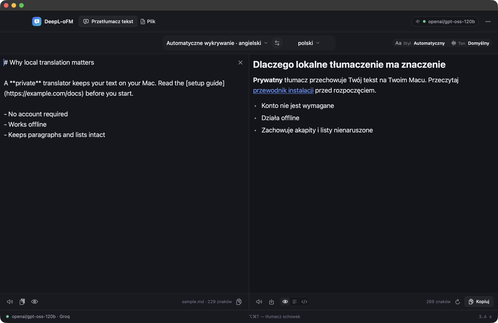
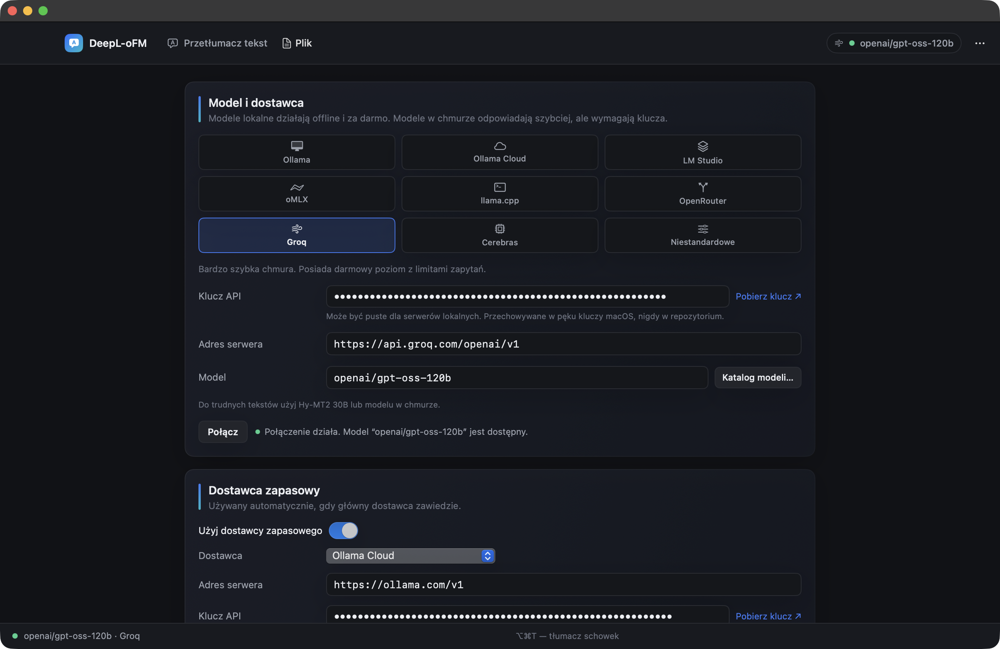

  

<h1 align="center">DeepL-oFM</h1>

  <b>Natywny tłumacz macOS dla modeli lokalnych i chmurowych. Zachowuje akapity, listy i Markdown. Hy-MT2 7B offline przez Ollama albo OpenRouter, Groq i Cerebras z własnym kluczem. Darmowy, prywatny i podpisany dla macOS.</b>

  <a href="README.md">English</a> · <a href="README.uk.md">Українська</a> · <a href="README.ru.md">Русский</a> · <a href="README.de.md">Deutsch</a> · <a href="README.fr.md">Français</a> · <a href="README.es.md">Español</a> · <b>Polski</b> · <a href="README.pt.md">Português</a> · <a href="README.it.md">Italiano</a>

  
  
  
  

  <a href="https://github.com/Lexus2016/deepl-on-free-models/releases/latest"><b>⬇ Pobierz DeepL-oFM dla macOS</b></a>
  · <a href="https://lexus2016.github.io/deepl-on-free-models/">Strona</a>

Brak powiązań z DeepL SE. „DeepL-oFM” opisuje styl interfejsu („on Free Models”).

  

## Dlaczego DeepL-oFM

Większość tłumaczy to najpierw strona internetowa. DeepL-oFM to najpierw natywna aplikacja Mac: modele lokalne domyślnie, zachowane formatowanie, bez konta i telemetrii. To samo okno może użyć modelu chmurowego, gdy potrzebna jest większa szybkość lub jakość.

## Funkcje

- Tłumaczenie w dwóch panelach ze wskaźnikiem postępu. Gotowy tekst pojawia się dopiero po sprawdzeniu każdego wiersza — bez częściowego tekstu i duplikatów.
- Automatyczne tłumaczenie podczas pisania (regulowane opóźnienie).
- Dwa globalne skróty: **⌥⌘T** — przetłumacz schowek; **⌥⌘C** — skopiuj zaznaczony tekst w dowolnej aplikacji, otwórz DeepL-oFM i przetłumacz go.
- 33 języki Hy-MT2 (38 wariantów) z wyszukiwaniem.
- Style **Auto / Dosłowny / Naturalny** i tony **Domyślny / Formalny / Swobodny**.
- Katalog modeli, przycisk **Połącz**, lista modeli i filtr nazw.
- Widoczny przycisk **Kopiuj**: Markdown, HTML i RTF naraz.
- **Wklejanie z formatowaniem**: HTML/RTF z przeglądarki lub edytora staje się Markdownem — nagłówki, listy, linki i wyróżnienia zostają.
- **Widok Markdown**: wyrenderowany, tylko tekst lub źródło; Kopiuj zależy od aktywnego widoku.
- **Pliki**: `.txt`, `.md`, `.pdf` i `.docx` do otwarcia lub przeciągnięcia; zapis w oryginalnym formacie.
- **DOCX** jest aktualizowany w miejscu (tylko `word/document.xml`); **PDF** zachowuje strony, układ, obrazy i typografię.
- **Dziewięć języków interfejsu**: angielski, ukraiński, rosyjski, niemiecki, francuski, hiszpański, polski, portugalski, włoski.
- Automatyczne aktualizacje przez **Sparkle 2** z podpisanym kanałem.
- Zapasowy dostawca, wstępne ładowanie przy starcie, historia, synteza mowy i ikona w pasku menu; ikonę w Docku można ukryć.

## Zrzuty ekranu

| | |
|---|---|
|  |  |
| **Tłumaczenie: postęp, gotowy tekst, widoczny przycisk Kopiuj** | **Ustawienia: dostawcy, lista modeli, dostawca zapasowy** |

## Języki

Lista tłumaczenia zawiera **38 wariantów 33 języków** (nazwy zależą od języka interfejsu):

Chinese, English, French, Portuguese, Spanish, Japanese, Turkish, Russian, Arabic, Korean, Thai, Italian, German, Vietnamese, Malay, Indonesian, Filipino, Hindi, Traditional Chinese, Polish, Czech, Dutch, Khmer, Burmese, Persian, Gujarati, Urdu, Telugu, Marathi, Hebrew, Bengali, Tamil, Ukrainian, Tibetan, Kazakh, Mongolian, Uyghur, Cantonese.

## Pliki

- **Tekst i Markdown** zachowują treść i strukturę wierszy.
- **DOCX** zachowuje oryginalny pakiet: podmieniany jest tylko `word/document.xml`, więc style, obrazy, tabele, nagłówki i czcionki pozostają nietknięte.
- **PDF** zachowuje oryginalne strony — układ, obrazy, grafiki i typografię — a tłumaczenie jest rysowane w tych samych blokach tekstu. Zeskanowane PDF wymagają najpierw OCR.

## Instalacja

1. Pobierz `DeepL-oFM.dmg` z najnowszego wydania.
2. Otwórz DMG i przeciągnij DeepL-oFM do **Aplikacji**.
3. Uruchom aplikację. DMG jest podpisany i notaryzowany; poprzednie wersje otrzymują aktualizację przez Sparkle.

## Pełna dokumentacja

Pełna dokumentacja (dostawcy, modele, kompilacja) jest w [angielskim README](README.md).

## License

MIT — zobacz [LICENSE](LICENSE).
