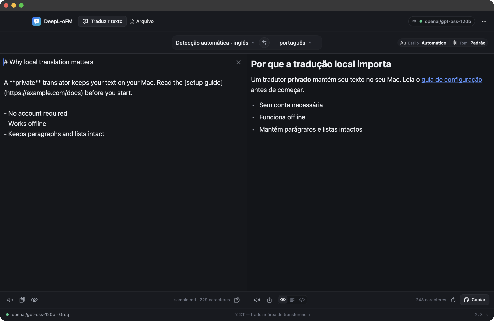
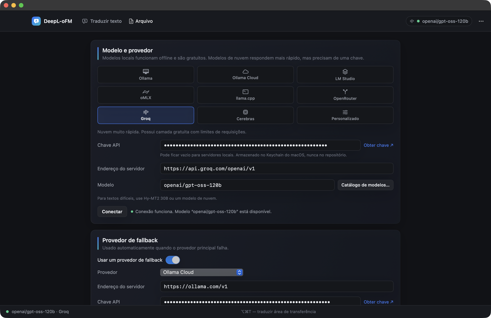

  

<h1 align="center">DeepL-oFM</h1>

  <b>Um tradutor nativo de macOS para modelos locais e na nuvem. Mantém parágrafos, listas e Markdown. Hy-MT2 7B offline via Ollama, ou OpenRouter, Groq e Cerebras com a sua chave. Gratuito, privado e assinado para macOS.</b>

  <a href="README.md">English</a> · <a href="README.uk.md">Українська</a> · <a href="README.ru.md">Русский</a> · <a href="README.de.md">Deutsch</a> · <a href="README.fr.md">Français</a> · <a href="README.es.md">Español</a> · <a href="README.pl.md">Polski</a> · <b>Português</b> · <a href="README.it.md">Italiano</a>

  
  
  
  

  <a href="https://github.com/Lexus2016/deepl-on-free-models/releases/latest"><b>⬇ Transferir DeepL-oFM para macOS</b></a>
  · <a href="https://lexus2016.github.io/deepl-on-free-models/">Site</a>

Sem afiliação com a DeepL SE. «DeepL-oFM» descreve o estilo da interface («on Free Models»).

  

## Porquê o DeepL-oFM

A maioria dos tradutores é primeiro um site. O DeepL-oFM é primeiro uma app nativa de Mac: modelos locais por omissão, formatação preservada, sem conta e sem telemetria. A mesma janela pode usar um modelo na nuvem quando precisa de mais velocidade ou qualidade.

## Funcionalidades

- Tradução em dois painéis com indicador de progresso. O texto final só aparece depois de cada linha verificada — sem texto parcial nem duplicados.
- Tradução automática enquanto escreve (atraso configurável).
- Dois atalhos globais: **⌥⌘T** — traduzir a área de transferência; **⌥⌘C** — copiar o texto selecionado em qualquer app, abrir o DeepL-oFM e traduzi-lo.
- 33 idiomas Hy-MT2 (38 variantes) com pesquisa.
- Estilos **Auto / Literal / Natural** e tons **Padrão / Formal / Casual**.
- Catálogo de modelos, botão **Ligar**, lista de modelos e filtro por nome.
- Botão **Copiar** visível: Markdown, HTML e RTF de uma vez.
- **Colagem com formatação**: HTML/RTF do navegador ou do processador de texto torna-se Markdown — títulos, listas, ligações e ênfases mantidos.
- **Vista Markdown**: renderizada, só texto ou código-fonte; Copiar segue a vista ativa.
- **Ficheiros**: `.txt`, `.md`, `.pdf` e `.docx` para abrir ou arrastar; guardar no formato original.
- **DOCX** é atualizado no local (apenas `word/document.xml`); **PDF** mantém as páginas, o layout, as imagens e a tipografia.
- **Nove idiomas de interface**: inglês, ucraniano, russo, alemão, francês, espanhol, polaco, português, italiano.
- Atualizações automáticas via **Sparkle 2** com um canal assinado.
- Fornecedor de reserva, pré-carregamento no arranque, histórico, voz do sistema e ícone na barra de menus; o ícone no Dock pode ser ocultado.

## Capturas de ecrã

| | |
|---|---|
|  |  |
| **Tradução: progresso, texto final, botão Copiar visível** | **Definições: fornecedores, lista de modelos, reserva** |

## Idiomas

A lista de tradução contém **38 variantes de 33 idiomas** (os nomes seguem o idioma da interface):

Chinese, English, French, Portuguese, Spanish, Japanese, Turkish, Russian, Arabic, Korean, Thai, Italian, German, Vietnamese, Malay, Indonesian, Filipino, Hindi, Traditional Chinese, Polish, Czech, Dutch, Khmer, Burmese, Persian, Gujarati, Urdu, Telugu, Marathi, Hebrew, Bengali, Tamil, Ukrainian, Tibetan, Kazakh, Mongolian, Uyghur, Cantonese.

## Ficheiros

- **Texto e Markdown** mantêm o conteúdo e a estrutura de linhas.
- **DOCX** mantém o pacote original: só `word/document.xml` é substituído, pelo que estilos, imagens, tabelas, cabeçalhos e tipos de letra ficam intactos.
- **PDF** mantém as páginas originais — layout, imagens, gráficos e tipografia — e pinta a tradução nos mesmos blocos de texto. PDFs digitalizados precisam primeiro de OCR.

## Instalação

1. Transfira `DeepL-oFM.dmg` da versão mais recente.
2. Abra o DMG e arraste o DeepL-oFM para **Aplicações**.
3. Inicie a app. O DMG é assinado e notarizado; versões anteriores recebem a atualização via Sparkle.

## Documentação completa

A documentação completa (fornecedores, modelos, compilação) está no [README em inglês](README.md).

## License

MIT — ver [LICENSE](LICENSE).
