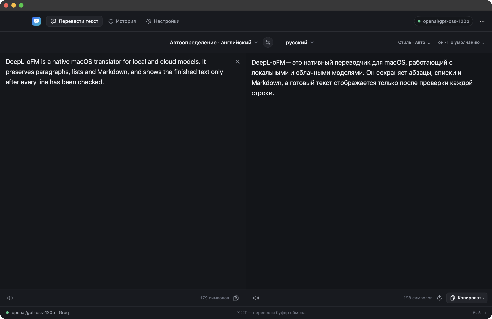
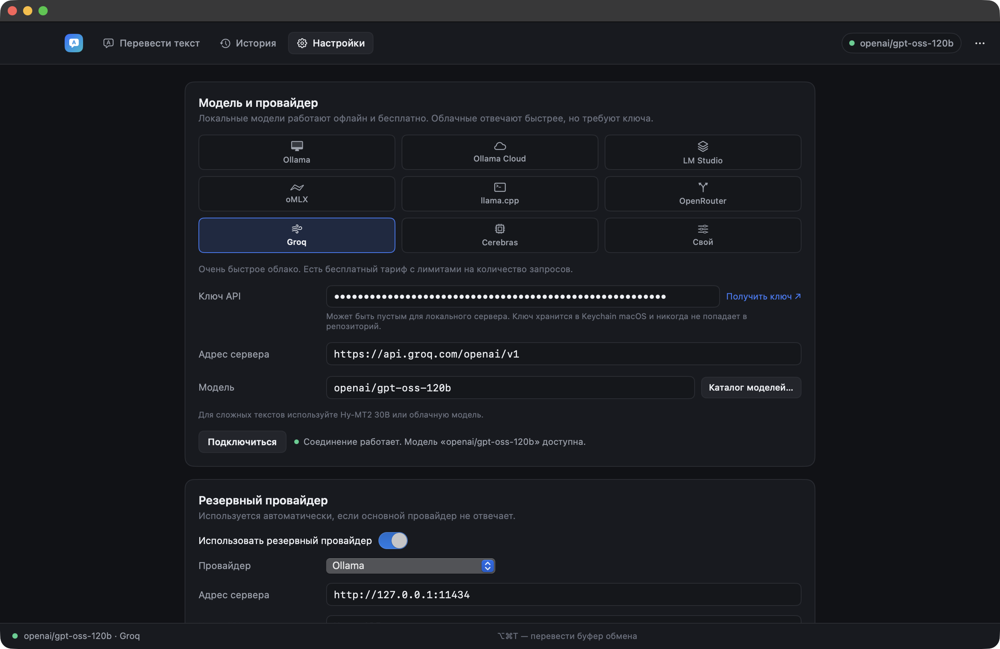
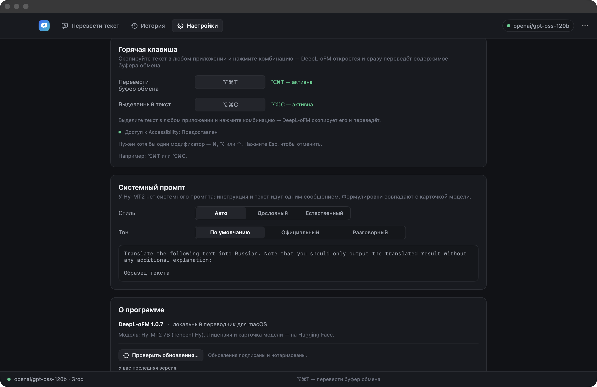

<p align="center">
  
</p>

<h1 align="center">DeepL-oFM</h1>

<p align="center">
  <b>Нативный переводчик для macOS на локальных и облачных моделях.</b><br>
  Сохраняет абзацы, списки и Markdown. Hy-MT2 7B работает офлайн через Ollama,
  а OpenRouter, Groq и Cerebras доступны с вашим ключом. Бесплатно, приватно
  и подписано для macOS.
</p>

<p align="center">
  <a href="README.md">English</a> · <a href="README.uk.md">Українська</a> · <b>Русский</b>
</p>

<p align="center">
  <a href="https://github.com/Lexus2016/deepl-on-free-models/releases/latest"></a>
  
  
  
</p>

<p align="center">
  <a href="https://github.com/Lexus2016/deepl-on-free-models/releases/latest"><b>⬇ Скачать DeepL-oFM для macOS</b></a>
  · <a href="https://lexus2016.github.io/deepl-on-free-models/">Сайт</a>
</p>

<p align="center"><sub>Не связан с DeepL SE. «DeepL-oFM» описывает стиль интерфейса («on Free Models»).</sub></p>

## Почему DeepL-oFM

Большинство переводчиков — это прежде всего сайт. DeepL-oFM — прежде всего
нативное приложение для Mac: локальные модели по умолчанию, сохранённое
форматирование, без аккаунта и телеметрии. В том же окне можно подключить
облачную модель, когда нужны скорость или качество.

## Возможности

- Двухпанельный перевод с индикатором прогресса. Готовый текст появляется только
  после проверки всех строк — без обрезанных фрагментов и повторов.
- Автоматический перевод во время ввода (задержка настраивается).
- Две глобальные горячие клавиши:
  - **⌥⌘T** — перевести содержимое буфера обмена;
  - **⌥⌘C** — скопировать выделенный текст в любом приложении, открыть
    DeepL-oFM и перевести его.
- 33 языка Hy-MT2 (38 вариантов в списке) с поиском языка.
- Стили **Авто / Дословный / Естественный** и тона **По умолчанию / Официальный /
  Разговорный** — по карточке модели Hy-MT2.
- Каталог моделей, кнопка **«Подключиться»**, список моделей провайдера и фильтр
  по названию.
- Видимая кнопка **«Копировать»**: кладёт в буфер Markdown, HTML и RTF
  одновременно.
- **Вставка с сохранением форматирования.** Скопированная страница или документ
  сохраняют заголовки, списки, ссылки и выделения: HTML/RTF превращается
  в Markdown ещё до перевода.
- **Просмотр Markdown.** В панели результата три вида: отформатированный
  Markdown, чистый текст без разметки и исходный Markdown. Копирование отдаёт
  именно активный вид — форматированный текст, чистый текст или Markdown.
- **Файлы.** Откройте `.txt`, `.md`, `.pdf` или `.docx` либо перетащите файл
  в окно; «Сохранить перевод» запишет документ в том же формате.
- **Автоматические обновления** через Sparkle 2: ежедневная проверка
  подписанного канала, кнопка **«Проверить обновления…»** и необязательная
  полностью автоматическая установка.
- **Необязательный резервный провайдер и модель.** Если основной провайдер не
  отвечает, тот же текст автоматически повторяется с выбранным резервом.
- **Предварительная загрузка при запуске.** Подключается к провайдеру,
  обновляет список моделей и загружает локальную модель в память; можно
  отключить в настройках.
- История переводов с поиском, копированием и удалением.
- Системное озвучивание оригинала и перевода.
- Интерфейс **на русском, украинском, английском, немецком, французском,
  испанском, польском, португальском и итальянском** (по системе).
- Иконка в меню-баре и быстрый перевод буфера оттуда.

## Скриншоты

| | |
|---|---|
|  |  |
| **Перевод:** прогресс, готовый текст, видимая кнопка «Копировать» | **Настройки:** провайдеры, живой список моделей, резерв |
|  | |
| **Обновления:** подписанный appcast, ежедневные проверки, ручная кнопка | |

## Языки

Список языков перевода содержит **38 вариантов 33 языков**:

китайский (упрощённый), английский, французский, португальский, испанский, японский, турецкий, русский, арабский, корейский, тайский, итальянский, немецкий, вьетнамский, малайский, индонезийский, филиппинский, хинди, китайский (традиционный), польский, чешский, нидерландский, кхмерский, бирманский, персидский, гуджарати, урду, телугу, маратхи, иврит, бенгальский, тамильский, украинский, тибетский, казахский, монгольский, уйгурский, кантонский.

Интерфейс приложения — английский, украинский, русский, немецкий,
французский, испанский, польский, португальский и итальянский. Сам выбор языка
перевода показывает все языки выше, а их названия соответствуют языку
интерфейса.

## Файлы

**Файл → Перевести файл…** (⌘O) открывает `.txt`, `.md`, `.pdf` или `.docx`;
файл можно также перетащить в окно. Текст попадает в панель источника,
переводится в обычных трёх видах, а **«Сохранить перевод…»** (⌘S) записывает
результат обратно:

- **Текст и Markdown** сохраняют содержимое и структуру строк.
- **DOCX** сохраняет стили, изображения, таблицы и списки; абзацы переводятся
  на месте, поэтому документ открывается в Word таким же, но с новым текстом.
- **PDF** перестраивается как чистый, выделяемый документ с переформатированным
  текстом. Исходное расположение не воспроизводится, а сканированные PDF
  сначала требуют OCR.

## Провайдеры

| Провайдер | Тип | Ключ API | Примечания |
|---|---|---|---|
| Ollama | локальный | не нужен | локальные модели и `-cloud` через `ollama signin` |
| Ollama Cloud | облачный | нужен | прямой `https://ollama.com/v1` |
| LM Studio | локальный | обычно не нужен | локальный сервер |
| oMLX | локальный | обычно не нужен | MLX-сервер для Apple Silicon |
| llama.cpp | локальный | обычно не нужен | `llama-server --api` |
| OpenRouter | облачный | нужен | бесплатные модели имеют суффикс `:free` |
| Groq | облачный | нужен | бесплатный тариф с лимитами |
| Cerebras | облачный | нужен | бесплатный тариф с лимитами |
| Свой | любой | необязательный | любой OpenAI-совместимый endpoint |

Поле ключа API доступно для **каждого** провайдера: для локального сервера
оставьте его пустым, если ваш прокси или LM Studio не требует токена. Ключи
хранятся в **Keychain macOS** и никогда не попадают в репозиторий.

## Модели

### Локально через Ollama

| Модель | ID | Размер | Языки |
|---|---|---|---|
| Hy-MT2 7B | `hy-mt2:7b` | ≈4,6 ГБ | 33 |
| Hy-MT2 1.8B | `hy-mt2:1.8b` | лёгкая | 33 |
| Hy-MT2 30B-A3B | `hy-mt2:30b` | большая, MoE | 33 |
| TranslateGemma 4B | `translategemma:4b` | ≈3 ГБ | 55 |
| TranslateGemma 12B | `translategemma:12b` | ≈8 ГБ | 55 |
| Qwen3.5-MT 2B | `qwen3.5-mt:2b` | 2B | перевод |
| Aya Expanse 8B | `aya-expanse:8b` | 8B | 23 |
| Qwen3 8B | `qwen3:8b` | 8B | общая |

```bash
ollama pull maternion/hy-mt2:7b
ollama cp maternion/hy-mt2:7b hy-mt2:7b
```

Кнопка **«Каталог моделей…»** в настройках показывает команды установки с
кнопкой копирования.

### Ollama Cloud — оба режима

1. **Через локальный демон Ollama.** Войдите и используйте модели `-cloud`:

   ```bash
   ollama signin
   ollama run gpt-oss:120b-cloud
   ```

   Выберите **Ollama** в приложении, нажмите **«Подключиться»** — список будет
   содержать и локальные, и `-cloud` модели. Ключ здесь не нужен: демон уже
   авторизован.

2. **Прямой API Ollama Cloud.** Выберите **Ollama Cloud** и вставьте ключ из
   [ollama.com/settings/keys](https://ollama.com/settings/keys). Адрес:
   `https://ollama.com/v1`; локальный сервер не нужен.

### Облачные провайдеры

- **OpenRouter** ([ключи](https://openrouter.ai/keys)): `tencent/hy-mt2-7b`,
  `tencent/hy-mt2-1.8b`, `tencent/hy-mt2-30b-a3b`; бесплатные модели, например
  `google/gemma-4-31b-it:free`, `google/gemma-4-26b-a4b-it:free`,
  `nvidia/nemotron-3-ultra-550b-a55b:free`, `inclusionai/ling-3.2-flash:free`;
  быстрые платные варианты `google/gemini-3.1-flash-lite`,
  `qwen/qwen3.7-flash`, `openai/gpt-5-mini`.
- **Groq** ([ключи](https://console.groq.com/keys)): `openai/gpt-oss-120b`
  (~500 т/с), `openai/gpt-oss-20b` (~1000 т/с),
  `llama-3.3-70b-versatile`, `qwen/qwen3.8-27b` (preview).
- **Cerebras** ([ключи](https://cloud.cerebras.ai)): `gpt-oss-120b`
  (~3000 т/с), `qwen-3.8-27b` (~1850 т/с).

Каталоги провайдеров меняются; **«Подключиться»** всегда получает актуальный
список с сервера.

## Установка

### Готовое приложение

Скачайте нотаризованный DMG из
[Releases](https://github.com/Lexus2016/deepl-on-free-models/releases),
откройте его и перетащите **DeepL-oFM** на папку **Applications** в том же окне.
Образ диска подписан и нотаризован; внутри есть приложение и ярлык Applications,
поэтому установка — обычное перетаскивание. Gatekeeper принимает приложение без
обхода через правый клик.

### Из исходного кода

Требуются macOS 14+, Xcode Command Line Tools и
[Ollama](https://ollama.com).

```bash
git clone https://github.com/Lexus2016/deepl-on-free-models.git
cd deepl-on-free-models

./setup.sh          # модель, тестовый перевод, сборка
# или вручную:
ollama pull maternion/hy-mt2:7b
ollama cp maternion/hy-mt2:7b hy-mt2:7b
./build.sh

open build/DeepL-oFM.app
cp -R build/DeepL-oFM.app /Applications/
```

Приложение живёт в меню-баре; закрытие окна не останавливает горячие клавиши.
Добавьте его в **Login Items**, если оно должно запускаться после перезагрузки.

## Первое подключение

1. **Настройки → Модель и провайдер**.
2. Выберите провайдера. Локальный Ollama имеет адрес `http://127.0.0.1:11434`.
3. Введите ключ API, если провайдер его требует.
4. Нажмите **«Подключиться»**: сервер проверяется, его модели показываются
   списком.
5. Отфильтруйте по части названия и выберите модель.
6. **«Каталог моделей…»** предлагает готовые переводческие модели с командами
   установки.

## Горячие клавиши и Accessibility

| Комбинация | Действие |
|---|---|
| **⌥⌘T** | перевести буфер обмена и вывести приложение вперёд |
| **⌥⌘C** | скопировать выделенный текст, открыть DeepL-oFM и перевести |

Обе меняются в **Настройки → Горячая клавиша**; нужен хотя бы один модификатор —
⌘, ⌥ или ⌃. Поле показывает фактическую клавишу, которую вы нажали (например,
`⌥'`, `⌥є`, `⌥⌘T`).

Для перевода выделенного нужен доступ к **Accessibility**: приложение
отправляет `⌘C` активному приложению. Статус и кнопка **«Открыть системные
настройки»** есть в настройках. Если доступ был выдан старой сборке, удалите
DeepL-oFM из списка Accessibility, добавьте текущее приложение и включите его.
Приложение показывает свой текущий путь.

`build.sh` подписывает **Developer ID Application** или **Apple Development**,
если сертификат есть в Keychain, поэтому Accessibility сохраняется между
сборками. С ad-hoc подписью разрешение может потребоваться выдать повторно.
Принудительно выбрать сертификат можно так:

```bash
HYMT_SIGN_IDENTITY="Developer ID Application: …" ./build.sh
```

## Язык интерфейса

**Настройки → Поведение → Язык интерфейса**: системный, английский, украинский,
русский, немецкий, французский, испанский, польский, португальский, итальянский. Изменения применяются сразу, без перезапуска. Промпты для модели
остаются английскими — на этом языке обучена Hy-MT2.

## Обновления

Приложение использует **Sparkle 2** с подписанным appcast:

- проверка раз в сутки (`SUScheduledCheckInterval = 86400`);
- **Настройки → О программе → Проверить обновления…** и команда в меню
  проверяют сразу;
- **Автоматически загружать и устанавливать обновления** включается отдельно
  (по умолчанию выключено);
- канал:
  [appcast.xml](https://raw.githubusercontent.com/Lexus2016/deepl-on-free-models/main/appcast.xml);
- каждый файл обновления подписан EdDSA (`SUPublicEDKey` в приложении), а DMG
  подписан и нотаризован. Sparkle отклоняет обновление, если подпись или
  подпись кода не совпадает.

Appcast генерируется инструментом `generate_appcast` и хранится в репозитории,
поэтому историю обновлений можно проверить.

## Резерв и запуск

- **Резервный провайдер** (Настройки → Резервный провайдер): включите, выберите
  провайдера, адрес, ключ API и модель. Ключ — тот же элемент Keychain, что и
  для основного использования этого провайдера. Если основной запрос не
  удаётся (соединение, HTTP-ошибка, отсутствующая модель), тот же текст
  автоматически повторяется с резервом, а в строке состояния появляется
  **резерв**.
- **Загружать переводчик при запуске** (Настройки → Поведение): подключается к
  провайдеру, обновляет список моделей и загружает локальную модель в память.
  Отключите, чтобы оставить только пассивную проверку соединения.

## Форматирование и прогресс

Текст делится на **строки**: каждая непустая строка переводится отдельно;
пустые строки сохраняются. Очень длинные строки делятся по предложениям и
склеиваются в одну строку. Окончания строк Windows (`CRLF`) и старый Mac (`CR`)
нормализуются.

- Заголовки `#`, маркеры списков `-`/`1.`, цитаты и отметки задач сохраняются;
  префикс присоединяется после перевода.
- Короткие строки переводятся нейтральной инструкцией: на дословном стиле
  модель начинала «разговаривать сама с собой» и выпускала ролевые токены.
  Более длинные фрагменты используют выбранный стиль.
- Длинные фрагменты с Markdown получают одно дополнительное предложение в
  инструкции, **перед финальным двоеточием**: сохранить заголовки, списки,
  жирный шрифт, курсив, ссылки и inline-код. Короткие фрагменты его не
  получают — на короткой строке эта инструкция иногда заставляла модель
  переписать ссылку вместо перевода.
- URL, e-mail, model ID и inline-код защищены и восстанавливаются дословно
  (`console.groq.com/keys`, `tencent/hy-mt2-7b`, `` `qwen3:8b` ``). Точка в
  конце предложения не становится частью URL.
- Пунктуация в конце строки (`:`, `;`, `.`, `!`, `?`) сохраняется; если модель
  изменила финальный знак, побеждает пунктуация оригинала.
- Каждый блок проверяется на пустой результат, повторы, китайские или
  кириллические символы, не принадлежащие целевому языку, ролевые токены, эхо
  инструкции, мета-ответы от первого лица и чрезмерную длину. Перевод на
  нелатинский язык должен содержать хотя бы один символ этого языка, поэтому
  английское предложение не может незаметно остаться в украинском абзаце.
  Неудачные блоки повторяются с меньшей температурой и другой инструкцией.
  Если длинный абзац всё равно не удаётся, приложение переводит его по
  предложениям и склеивает строку; известные обёртки («Вот перевод:»)
  снимаются. Если строку всё равно не удалось стабильно перевести, она
  остаётся на языке оригинала, а внизу появляется предупреждение — остальной
  текст переводится дальше.

Во время перевода панель показывает **прогресс** (`X из Y`), а не промежуточный
текст. Готовый перевод появляется сразу после завершения.

## Копирование и Markdown

Кнопка **«Копировать»** кладёт в буфер три формата:

- **Markdown** — для чатов, GitHub и простых редакторов;
- **HTML** — для Notes, Word, браузера;
- **RTF** — для программ, предпочитающих rich text.

Заголовки, списки, цитаты, `**жирный**`, `*курсив*`, ссылки и `` `код` ``
сохраняются, если были в исходном тексте; HTML/RTF-версия рендерит их
форматированными. Ссылки рендерятся только для `http`, `https`, `mailto` и
относительных URL; цель `javascript:` отбрасывается. Inline-форматирование,
которое TextEditor не сохранил при вставке (например, жирный шрифт из браузера),
не восстанавливается. Блоки кода в тройных кавычках переводятся как обычные
строки, а не как код. `⇧⌘C` также копирует перевод.

## Промпты

У Hy-MT2 нет системного промпта: инструкция и текст идут одним сообщением.

| Стиль | Инструкция |
|---|---|
| Авто | `Translate the following text into {target_language}. Note that you should only output the translated result without any additional explanation:` |
| Дословный | `Please translate the following text into {target_language}. Note that the translation style must strictly conform to [literal, word for word]:` |
| Естественный | `Please translate the following text into {target_language}. Note that the translation style must strictly conform to [natural and idiomatic, conveying the meaning rather than the wording]:` |

Суффикс тона: `; formal and professional` или `; casual and conversational`.
Авто + «По умолчанию» даёт базовую инструкцию. Сгенерированный промпт виден в
**Настройки → Системный промпт**.

## Параметры

Использованы значения Tencent для Hy-MT2 7B:

```
temperature    = 0.7
top_p          = 0.6
top_k          = 20
repeat_penalty = 1.05
num_ctx        = 8192
```

Все редактируются. Если язык оригинала определён автоматически и совпадает с
целевым, приложение выбирает другой язык (язык интерфейса или другую сторону
пары), а не переводит текст сам в себя.

## Безопасность и приватность

- Ключи API хранятся в **Keychain macOS**, отдельно для каждого провайдера. Они
  не пишутся в UserDefaults, логи, историю или репозиторий.
- В репозитории нет ключей, токенов, `.env`-файлов или моделей; `.gitignore`
  исключает `build/`, `.build/`, `.env*`, `*.key`, `*.pem`, `*.gguf`, логи и
  sqlite-файлы.
- Локальные модели (Ollama, LM Studio, oMLX, llama.cpp) оставляют текст на
  машине.
- Облачные провайдеры получают текст на своих условиях.
- Нет телеметрии, аналитики или фоновых соединений с серверами авторов.
- Accessibility используется только для отправки `⌘C` перед переводом
  выделенного.

См. [SECURITY.ru.md](SECURITY.ru.md). Если ключ утёк, немедленно отзовите его в панели
провайдера.

## Устранение проблем

- **Модель не найдена** — проверьте `ollama list`; нажмите **«Подключиться»**,
  чтобы увидеть актуальный список. Название должно совпадать точно.
- **Сервер недоступен** — запустите `ollama serve` или соответствующий сервер и
  проверьте адрес.
- **HTTP 401/403** — проверьте облачный ключ API.
- **Часть строк осталась на языке оригинала** — нажмите **«Повторить»** или
  смените стиль/модель. Модель иногда даёт нестабильный результат; приложение
  отбрасывает повторы и ролевые токены.
- **Выделенный текст не копируется** — предоставьте Accessibility; если
  разрешение было выдано старой сборке, удалите старую запись и добавьте
  текущее приложение.
- **Горячая клавиша не работает** — комбинация может быть занята; запишите
  другую.
- **Бренды или аббревиатуры переведены неточно** — модель 7B может ошибаться в
  терминах; попробуйте «Естественный» стиль или другую модель.
- Запуск с debug-логом:

  ```bash
  DEEPLOFM_DEBUG=1 ./build/DeepL-oFM.app/Contents/MacOS/DeepL-oFM --prefill "Hello world"
  ```

## Архитектура

```
Sources/HyMT/
  DeepL-oFMApp.swift        точка входа, меню, AppDelegate
  AppState.swift            состояние, debounce, история, горячие клавиши, прогресс
  Models/                   языки, промпты, настройки, провайдеры, каталог
  Services/                 перевод (Ollama/OpenAI streaming), probe,
                            горячие клавиши, история
  Views/                    интерфейс SwiftUI
  Support/                  локализация, Keychain, буфер, санитайзеры
Tests/HyMTTests/            юнит-тесты (промпты, чанкер, токены, буфер)
docs/screenshots/{en,uk,ru}/ скриншоты реального приложения для каждого языка README
```

Данные: `~/Library/Application Support/DeepL-oFM/history.json`; настройки в
`UserDefaults` (`ua.admin.hymt`); ключи в Keychain (`ua.admin.hymt`). Внутренний
bundle identifier сохранён, чтобы Accessibility, настройки и существующие ключи
пережили переименование из HyMT; файл истории один раз мигрирует из старой папки
`Application Support/HyMT`.

## Состояние и ограничения

- Встроенная модель 7B небольшая. Она может ошибаться в аббревиатурах и названиях
  брендов (например, `т/с` как «tons per second»), а на отдельных коротких
  фрагментах всё ещё даёт нестабильный результат. Приложение отбрасывает
  деградацию и оставляет строку оригинала с предупреждением; нажмите
  **«Повторить»**, переключите на **«Естественный»** или выберите большую/
  облачную модель.
- Форматирование построчное: каждая строка оригинала — отдельная единица
  перевода. Абзац, жёстко разбитый на несколько строк, сохранит эти разрывы; он
  не переформатируется.
- Inline-форматирование, поступающее как rich text (жирный шрифт или ссылки,
  вставленные из браузера в TextEditor), приложению недоступно. Markdown-разметка,
  введённая или вставленная как символы, сохраняется.
- Глоссария или памяти терминов пока нет. Это сознательно: приложение остаётся
  прозрачным клиентом к выбранной вами модели.

## Сборка подписанного релиза

`build.sh` подписывает бандл **Developer ID Application**, если сертификат есть в
Keychain, иначе — Apple Development, иначе — ad-hoc. Путь Developer ID включает
hardened runtime и защищённый timestamp, необходимые для нотаризации. Скрипт
также встраивает и подписывает `Sparkle.framework` из SwiftPM, добавляет rpath
`@executable_path/../Frameworks` и проверяет подпись всего бандла.

```bash
./build.sh
ditto -c -k --keepParent build/DeepL-oFM.app build/DeepL-oFM.zip

xcrun notarytool submit build/DeepL-oFM.zip \
  --keychain-profile "your-notary-profile" --wait
xcrun stapler staple build/DeepL-oFM.app

# DMG с ярлыком Applications для перетаскивания
STAGE=build/dmg-stage
rm -rf "$STAGE"
mkdir -p "$STAGE"
ditto build/DeepL-oFM.app "$STAGE/DeepL-oFM.app"
ln -s /Applications "$STAGE/Applications"
hdiutil create -volname "DeepL-oFM" -srcfolder "$STAGE" \
  -ov -format UDZO build/DeepL-oFM.dmg

codesign --force --timestamp --sign "Developer ID Application: …" build/DeepL-oFM.dmg
xcrun notarytool submit build/DeepL-oFM.dmg \
  --keychain-profile "your-notary-profile" --wait
xcrun stapler staple build/DeepL-oFM.dmg
```

Затем сгенерировать и подписать канал Sparkle:

```bash
mkdir -p build/appcast
cp build/DeepL-oFM.dmg build/appcast/
cp release-notes.md build/appcast/DeepL-oFM.md
.build/artifacts/sparkle/Sparkle/bin/generate_appcast \
  --account deepl-ofm \
  --download-url-prefix "https://github.com/Lexus2016/deepl-on-free-models/releases/download/vX.Y.Z/" \
  build/appcast

cp build/appcast/appcast.xml appcast.xml
.build/artifacts/sparkle/Sparkle/bin/sign_update --account deepl-ofm appcast.xml
.build/artifacts/sparkle/Sparkle/bin/sign_update --account deepl-ofm --verify appcast.xml
```

Закоммитьте подписанный `appcast.xml` и загрузите DMG и appcast в GitHub
release. Приватный ключ EdDSA остаётся в Keychain; в `Info.plist` только
публичный. Подпись канала и каждого файла обновления проверяется этим ключом.

`notarytool` использует профиль, созданный один раз через
`xcrun notarytool store-credentials`; пароль не должен попадать в репозиторий.

## Участие в разработке

См. [CONTRIBUTING.ru.md](CONTRIBUTING.ru.md) — правила сборки, тестов, скриншотов и релизов. Изменения — в [CHANGELOG.md](CHANGELOG.md).

## Лицензия

Код: MIT. Hy-MT2 7B распространяет Tencent по собственной лицензии; см.
[huggingface.co/tencent/Hy-MT2-7B](https://huggingface.co/tencent/Hy-MT2-7B).
