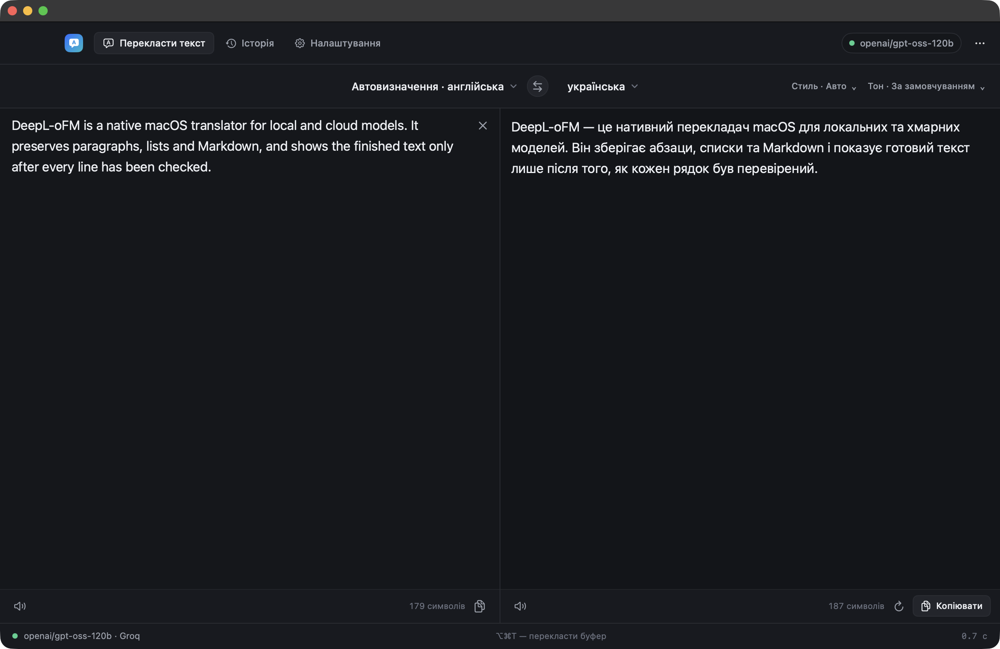
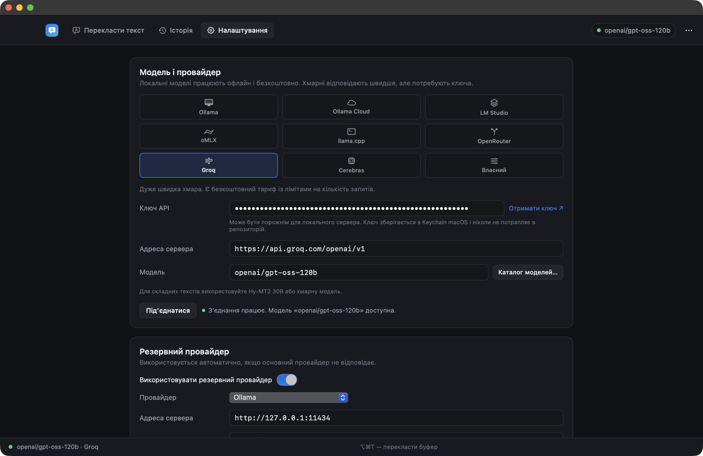
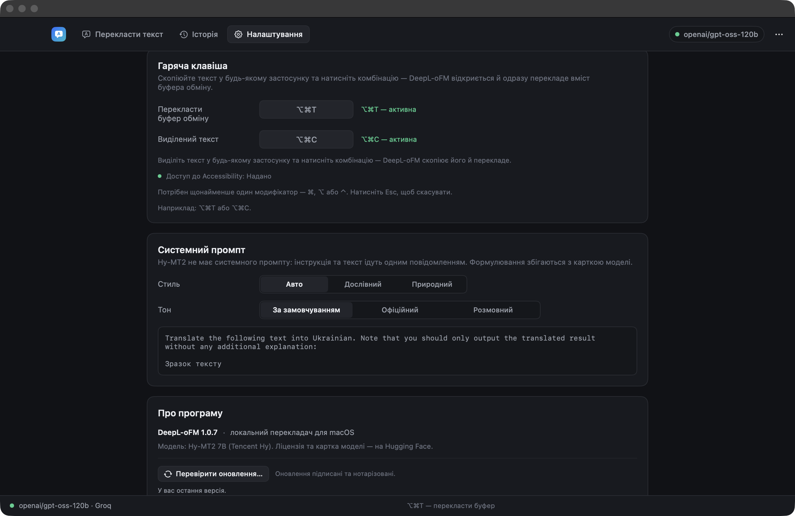

<p align="center">
  
</p>

<h1 align="center">DeepL-oFM</h1>

<p align="center">
  <b>Нативний перекладач для macOS на локальних і хмарних моделях.</b><br>
  Зберігає абзаци, списки й Markdown. Hy-MT2 7B працює офлайн через Ollama,
  а OpenRouter, Groq і Cerebras доступні з вашим ключем. Безкоштовно, приватно
  й підписано для macOS.
</p>

<p align="center">
  <a href="README.md">English</a> · <b>Українська</b> · <a href="README.ru.md">Русский</a>
</p>

<p align="center">
  <a href="https://github.com/Lexus2016/deepl-on-free-models/releases/latest"></a>
  
  
  
</p>

<p align="center">
  <a href="https://github.com/Lexus2016/deepl-on-free-models/releases/latest"><b>⬇ Завантажити DeepL-oFM для macOS</b></a>
  · <a href="https://lexus2016.github.io/deepl-on-free-models/">Сайт</a>
</p>

<p align="center"><sub>Не пов'язаний із DeepL SE. «DeepL-oFM» описує стиль інтерфейсу («on Free Models»).</sub></p>

<p align="center">
  
</p>

## Чому DeepL-oFM

Більшість перекладачів — це насамперед сайт. DeepL-oFM — насамперед нативний
застосунок для Mac: локальні моделі за замовчуванням, збережене форматування,
без акаунта й телеметрії. У тому самому вікні можна підключити хмарну модель,
коли потрібні швидкість або якість.

## Можливості

- Двопанельний переклад з індикатором прогресу. Готовий текст з'являється лише
  після перевірки всіх рядків — без обрізаних шматків і повторів.
- Автоматичний переклад під час введення (затримка налаштовується).
- Дві глобальні гарячі клавіші:
  - **⌥⌘T** — перекласти вміст буфера обміну;
  - **⌥⌘C** — скопіювати виділений текст у будь-якому застосунку, відкрити
    DeepL-oFM і перекласти його.
- 33 мови Hy-MT2 (38 варіантів у списку) з пошуком мови.
- Стилі **Авто / Дослівний / Природний** і тони **За замовчуванням / Офіційний /
  Розмовний** — за карткою моделі Hy-MT2.
- Каталог моделей, кнопка **«Під'єднатися»**, список моделей провайдера й фільтр
  за назвою.
- Видима кнопка **«Копіювати»**: кладе в буфер Markdown, HTML і RTF одночасно.
- **Вставка зі збереженням форматування.** Скопійована сторінка чи документ
  зберігають заголовки, списки, посилання й наголоси: HTML/RTF перетворюється
  на Markdown ще до перекладу.
- **Перегляд Markdown.** У панелі результату три вигляди: відформатований
  Markdown, чистий текст без розмітки і вихідний Markdown. Копіювання віддає
  саме активний вигляд — форматований текст, чистий текст або Markdown.
- **Файли.** Відкрийте `.txt`, `.md`, `.pdf` або `.docx` чи перетягніть файл
  у вікно; «Зберегти переклад» запише документ у тому ж форматі.
- **Автоматичні оновлення** через Sparkle 2: щоденна перевірка підписаного
  каналу, кнопка **«Перевірити оновлення…»** і необов'язкове повністю
  автоматичне встановлення.
- **Необов'язковий резервний провайдер і модель.** Якщо основний провайдер не
  відповідає, той самий текст автоматично повторюється з вибраним резервом.
- **Попереднє завантаження під час запуску.** Підключається до провайдера,
  оновлює список моделей і завантажує локальну модель у пам'ять; можна
  вимкнути в налаштуваннях.
- Історія перекладів із пошуком, копіюванням і видаленням.
- Системне озвучення оригіналу й перекладу.
- Інтерфейс **українською, російською, англійською, німецькою, французькою,
  іспанською, польською, португальською та італійською** (за системою).
- Іконка в меню-барі та швидкий переклад буфера звідти.

## Скріншоти

| | |
|---|---|
|  |  |
| **Переклад:** прогрес, готовий текст, видима кнопка «Копіювати» | **Налаштування:** провайдери, живий список моделей, резерв |
|  | |
| **Оновлення:** підписаний appcast, щоденні перевірки, ручна кнопка | |

## Мови

Список мов перекладу містить **38 варіантів 33 мов**:

китайська, англійська, французька, португальська, іспанська, японська, турецька, російська, арабська, корейська, тайська, італійська, німецька, в'єтнамська, малайська, індонезійська, філіппінська, гінді, китайська (традиційна), польська, чеська, нідерландська, кхмерська, бірманська, перська, гуджараті, урду, телугу, маратхі, іврит, бенгальська, тамільська, українська, тибетська, казахська, монгольська, уйгурська, кантонська.

Інтерфейс застосунку — англійська, українська, російська, німецька,
французька, іспанська, польська, португальська та італійська. Сам вибір мови
перекладу показує всі мови вище, а їхні назви відповідають мові інтерфейсу.

## Файли

**Файл → Перекласти файл…** (⌘O) відкриває `.txt`, `.md`, `.pdf` або `.docx`;
файл можна також перетягнути у вікно. Текст потрапляє в панель джерела,
перекладається у звичайних трьох виглядах, а **«Зберегти переклад…»** (⌘S)
записує результат назад:

- **Текст і Markdown** зберігають вміст і структуру рядків.
- **DOCX** зберігає оригінальний пакет: оновлюється лише `word/document.xml`,
  тому стилі, зображення, таблиці, списки, колонтитули й шрифти не змінюються.
- **PDF** зберігає оригінальні сторінки — верстку, зображення, графіки й
  типографіку — а переклад малюється поверх тих самих текстових блоків.
  Скановані PDF спершу потребують OCR.

## Провайдери

| Провайдер | Тип | Ключ API | Примітки |
|---|---|---|---|
| Ollama | локальний | не потрібен | локальні моделі та `-cloud` через `ollama signin` |
| Ollama Cloud | хмарний | потрібен | прямий `https://ollama.com/v1` |
| LM Studio | локальний | зазвичай не потрібен | локальний сервер |
| oMLX | локальний | зазвичай не потрібен | MLX-сервер для Apple Silicon |
| llama.cpp | локальний | зазвичай не потрібен | `llama-server --api` |
| OpenRouter | хмарний | потрібен | безкоштовні моделі мають суфікс `:free` |
| Groq | хмарний | потрібен | безкоштовний тариф із лімітами |
| Cerebras | хмарний | потрібен | безкоштовний тариф із лімітами |
| Власний | будь-який | необов'язковий | будь-який OpenAI-сумісний endpoint |

Поле ключа API доступне для **кожного** провайдера: для локального сервера
залиште його порожнім, якщо ваш проксі або LM Studio не вимагає токена. Ключі
зберігаються в **Keychain macOS** і ніколи не потрапляють у репозиторій.

## Моделі

### Локально через Ollama

| Модель | ID | Розмір | Мови |
|---|---|---|---|
| Hy-MT2 7B | `hy-mt2:7b` | ≈4,6 ГБ | 33 |
| Hy-MT2 1.8B | `hy-mt2:1.8b` | легка | 33 |
| Hy-MT2 30B-A3B | `hy-mt2:30b` | велика, MoE | 33 |
| TranslateGemma 4B | `translategemma:4b` | ≈3 ГБ | 55 |
| TranslateGemma 12B | `translategemma:12b` | ≈8 ГБ | 55 |
| Qwen3.5-MT 2B | `qwen3.5-mt:2b` | 2B | переклад |
| Aya Expanse 8B | `aya-expanse:8b` | 8B | 23 |
| Qwen3 8B | `qwen3:8b` | 8B | загальна |

```bash
ollama pull maternion/hy-mt2:7b
ollama cp maternion/hy-mt2:7b hy-mt2:7b
```

Кнопка **«Каталог моделей…»** у налаштуваннях показує команди встановлення з
кнопкою копіювання.

### Ollama Cloud — обидва режими

1. **Через локальний демон Ollama.** Увійдіть і використовуйте моделі `-cloud`:

   ```bash
   ollama signin
   ollama run gpt-oss:120b-cloud
   ```

   Оберіть **Ollama** у застосунку, натисніть **«Під'єднатися»** — список
   міститиме і локальні, і `-cloud` моделі. Ключ тут не потрібен: демон уже
   автентифікований.

2. **Прямий API Ollama Cloud.** Оберіть **Ollama Cloud** і вставте ключ з
   [ollama.com/settings/keys](https://ollama.com/settings/keys). Адреса:
   `https://ollama.com/v1`; локальний сервер не потрібен.

### Хмарні провайдери

- **OpenRouter** ([ключі](https://openrouter.ai/keys)): `tencent/hy-mt2-7b`,
  `tencent/hy-mt2-1.8b`, `tencent/hy-mt2-30b-a3b`; безкоштовні моделі, як-от
  `google/gemma-4-31b-it:free`, `google/gemma-4-26b-a4b-it:free`,
  `nvidia/nemotron-3-ultra-550b-a55b:free`, `inclusionai/ling-3.2-flash:free`;
  швидкі платні варіанти `google/gemini-3.1-flash-lite`,
  `qwen/qwen3.7-flash`, `openai/gpt-5-mini`.
- **Groq** ([ключі](https://console.groq.com/keys)): `openai/gpt-oss-120b`
  (~500 т/с), `openai/gpt-oss-20b` (~1000 т/с),
  `llama-3.3-70b-versatile`, `qwen/qwen3.8-27b` (preview).
- **Cerebras** ([ключі](https://cloud.cerebras.ai)): `gpt-oss-120b`
  (~3000 т/с), `qwen-3.8-27b` (~1850 т/с).

Каталоги провайдерів змінюються; **«Під'єднатися»** завжди отримує актуальний
список із сервера.

## Встановлення

### Готовий застосунок

Завантажте нотарізований DMG зі
[Releases](https://github.com/Lexus2016/deepl-on-free-models/releases),
відкрийте його та перетягніть **DeepL-oFM** на теку **Applications** у тому
самому вікні. Образ диска підписаний і нотарізований; усередині є застосунок і
ярлик Applications, тому встановлення — звичайне перетягування. Gatekeeper
приймає застосунок без обходу через правий клік.

### З вихідного коду

Потрібні macOS 14+, Xcode Command Line Tools і
[Ollama](https://ollama.com).

```bash
git clone https://github.com/Lexus2016/deepl-on-free-models.git
cd deepl-on-free-models

./setup.sh          # модель, тестовий переклад, збірка
# або вручну:
ollama pull maternion/hy-mt2:7b
ollama cp maternion/hy-mt2:7b hy-mt2:7b
./build.sh

open build/DeepL-oFM.app
cp -R build/DeepL-oFM.app /Applications/
```

Застосунок живе в меню-барі; закриття вікна не зупиняє гарячі клавіші. Додайте
його до **Login Items**, якщо він має запускатися після перезавантаження.

## Перше підключення

1. **Налаштування → Модель і провайдер**.
2. Оберіть провайдера. Локальний Ollama має адресу `http://127.0.0.1:11434`.
3. Введіть ключ API, якщо провайдер його вимагає.
4. Натисніть **«Під'єднатися»**: сервер перевіряється, його моделі показуються
   списком.
5. Відфільтруйте за частиною назви й оберіть модель.
6. **«Каталог моделей…»** пропонує готові перекладацькі моделі з командами
   встановлення.

## Гарячі клавіші та Accessibility

| Комбінація | Дія |
|---|---|
| **⌥⌘T** | перекласти буфер обміну й вивести застосунок уперед |
| **⌥⌘C** | скопіювати виділений текст, відкрити DeepL-oFM і перекласти |

Обидві змінюються в **Налаштування → Гаряча клавіша**; потрібен щонайменше один
модифікатор — ⌘, ⌥ або ⌃. Поле показує фактичну клавішу, яку ви натиснули
(наприклад, `⌥'`, `⌥є`, `⌥⌘T`).

Для перекладу виділеного потрібен доступ до **Accessibility**: застосунок
надсилає `⌘C` активному застосунку. Статус і кнопка **«Відкрити системні
налаштування»** є в налаштуваннях. Якщо доступ було надано старій збірці,
видаліть DeepL-oFM зі списку Accessibility, додайте поточний застосунок і
увімкніть його. Застосунок показує свій поточний шлях.

`build.sh` підписує **Developer ID Application** або **Apple Development**, якщо
сертифікат є в Keychain, тому Accessibility зберігається між збірками. З
ad-hoc підписом дозвіл може знадобитися надати повторно. Примусово вибрати
сертифікат можна так:

```bash
HYMT_SIGN_IDENTITY="Developer ID Application: …" ./build.sh
```

## Мова інтерфейсу

**Налаштування → Поведінка → Мова інтерфейсу**: системна, англійська,
українська, російська, німецька, французька, іспанська, польська,
португальська, італійська. Зміни застосовуються одразу, без перезапуску. Промпти
для моделі залишаються англійською — мовою, на якій навчена Hy-MT2.

## Оновлення

Застосунок використовує **Sparkle 2** із підписаним appcast:

- перевірка раз на добу (`SUScheduledCheckInterval = 86400`);
- **Налаштування → Про програму → Перевірити оновлення…** і команда в меню
  перевіряють негайно;
- **Автоматично завантажувати й встановлювати оновлення** вмикається окремо
  (за замовчуванням вимкнено);
- канал:
  [appcast.xml](https://raw.githubusercontent.com/Lexus2016/deepl-on-free-models/main/appcast.xml);
- кожен файл оновлення підписаний EdDSA (`SUPublicEDKey` у застосунку), а DMG
  підписаний і нотарізований. Sparkle відхиляє оновлення, якщо підпис або
  підпис коду не збігається.

Appcast генерується інструментом `generate_appcast` і зберігається в
репозиторії, тому історію оновлень можна перевірити.

## Резерв і запуск

- **Резервний провайдер** (Налаштування → Резервний провайдер): увімкніть,
  виберіть провайдера, адресу, ключ API й модель. Ключ — той самий елемент
  Keychain, що й для основного використання цього провайдера. Якщо основний
  запит не вдається (з'єднання, HTTP-помилка, відсутня модель), той самий текст
  автоматично повторюється з резервом, а в статус-барі з'являється **резерв**.
- **Завантажувати перекладач під час запуску** (Налаштування → Поведінка):
  підключається до провайдера, оновлює список моделей і завантажує локальну
  модель у пам'ять. Вимкніть, щоб залишити лише пасивну перевірку з'єднання.

## Форматування та прогрес

Текст ділиться на **рядки**: кожен непорожній рядок перекладається окремо;
порожні рядки зберігаються. Дуже довгі рядки діляться за реченнями й склеюються
в один рядок. Закінчення рядків Windows (`CRLF`) та старий Mac (`CR`)
нормалізуються.

- Заголовки `#`, маркери списків `-`/`1.`, цитати й позначки завдань
  зберігаються; префікс приєднується після перекладу.
- Короткі рядки переводяться нейтральною інструкцією: на дослівному стилі
  модель починала «розмовляти сама з собою» й випускала рольові токени. Довші
  фрагменти використовують обраний стиль.
- Довгі фрагменти з Markdown отримують одне додаткове речення в інструкції,
  **перед фінальною двокрапкою**: зберегти заголовки, списки, жирний шрифт,
  курсив, посилання й inline-код. Короткі фрагменти його не отримують — на
  короткому рядку ця інструкція іноді змушувала модель переписати посилання
  замість перекладу.
- URL, e-mail, model ID та inline-код захищені й відновлюються дослівно
  (`console.groq.com/keys`, `tencent/hy-mt2-7b`, `` `qwen3:8b` ``). Крапка в
  кінці речення не стає частиною URL.
- Пунктуація в кінці рядка (`:`, `;`, `.`, `!`, `?`) зберігається; якщо модель
  змінила фінальний знак, перемагає пунктуація оригіналу.
- Кожен блок перевіряється на порожній результат, повторення, китайські або
  кириличні символи, що не належать цільовій мові, рольові токени, відлуння
  інструкції, мета-відповіді від першої особи та надмірну довжину. Переклад
  нелатинською мовою мусить містити хоча б один символ цієї мови, тому
  англійське речення не може непомітно залишитися в українському абзаці.
  Невдалі блоки повторюються з нижчою температурою та іншою інструкцією. Якщо
  довгий абзац усе одно не вдається, застосунок перекладає його речення за
  реченням і склеює рядок; відомі обгортки («Ось переклад:») знімаються. Якщо
  рядок усе одно не вдалося стабільно перекласти, він залишається мовою
  оригіналу, а внизу з'являється попередження — решта тексту перекладається
  далі.

Під час перекладу панель показує **прогрес** (`X з Y`), а не проміжний текст.
Готовий переклад з'являється одразу після завершення.

## Копіювання та Markdown

Кнопка **«Копіювати»** кладе в буфер три формати:

- **Markdown** — для чатів, GitHub і простих редакторів;
- **HTML** — для Notes, Word, браузера;
- **RTF** — для програм, які надають перевагу rich text.

Заголовки, списки, цитати, `**жирний**`, `*курсив*`, посилання й `` `код` ``
зберігаються, якщо були у вихідному тексті; HTML/RTF-версія рендерить їх
форматованими. Посилання рендеряться лише для `http`, `https`, `mailto` і
відносних URL; ціль `javascript:` відкидається. Inline-форматування, яке
TextEditor не зберіг під час вставки (наприклад, жирний шрифт із браузера), не
відновлюється. Блоки коду в потрійних лапках перекладаються як звичайні рядки,
а не як код. `⇧⌘C` також копіює переклад.

## Промпти

Hy-MT2 не має системного промпту: інструкція й текст ідуть одним повідомленням.

| Стиль | Інструкція |
|---|---|
| Авто | `Translate the following text into {target_language}. Note that you should only output the translated result without any additional explanation:` |
| Дослівний | `Please translate the following text into {target_language}. Note that the translation style must strictly conform to [literal, word for word]:` |
| Природний | `Please translate the following text into {target_language}. Note that the translation style must strictly conform to [natural and idiomatic, conveying the meaning rather than the wording]:` |

Суфікс тону: `; formal and professional` або `; casual and conversational`.
Авто + «За замовчуванням» дає базову інструкцію. Згенерований промпт видно в
**Налаштування → Системний промпт**.

## Параметри

Використано значення Tencent для Hy-MT2 7B:

```
temperature    = 0.7
top_p          = 0.6
top_k          = 20
repeat_penalty = 1.05
num_ctx        = 8192
```

Усі редагуються. Якщо мову оригіналу визначено автоматично і вона збігається з
цільовою, застосунок обирає іншу мову (мову інтерфейсу або інший бік пари), а не
перекладає текст сам у себе.

## Безпека та приватність

- Ключі API зберігаються в **Keychain macOS**, окремо для кожного провайдера.
  Вони не пишуться в UserDefaults, логи, історію чи репозиторій.
- У репозиторії немає ключів, токенів, `.env`-файлів чи моделей; `.gitignore`
  виключає `build/`, `.build/`, `.env*`, `*.key`, `*.pem`, `*.gguf`, логи та
  sqlite-файли.
- Локальні моделі (Ollama, LM Studio, oMLX, llama.cpp) залишають текст на
  машині.
- Хмарні провайдери отримують текст на своїх умовах.
- Немає телеметрії, аналітики чи фонових з'єднань із серверами авторів.
- Accessibility використовується лише для надсилання `⌘C` перед перекладом
  виділеного.

Див. [SECURITY.uk.md](SECURITY.uk.md). Якщо ключ витік, негайно відкличте його в
панелі провайдера.

## Усунення проблем

- **Модель не знайдена** — перевірте `ollama list`; натисніть
  **«Під'єднатися»**, щоб побачити актуальний список. Назва має збігатися точно.
- **Сервер недоступний** — запустіть `ollama serve` або відповідний сервер і
  перевірте адресу.
- **HTTP 401/403** — перевірте хмарний ключ API.
- **Частина рядків залишилася мовою оригіналу** — натисніть **«Повторити»** або
  змініть стиль/модель. Модель іноді дає нестабільний результат; застосунок
  відкидає повтори й рольові токени.
- **Виділений текст не копіюється** — надайте Accessibility; якщо дозвіл було
  надано старій збірці, видаліть старий запис і додайте поточний застосунок.
- **Гаряча клавіша не працює** — комбінація може бути зайнята; запишіть іншу.
- **Бренди або абревіатури перекладені неточно** — модель 7B може помилятися в
  термінах; спробуйте «Природний» стиль або іншу модель.
- Запуск із debug-логом:

  ```bash
  DEEPLOFM_DEBUG=1 ./build/DeepL-oFM.app/Contents/MacOS/DeepL-oFM --prefill "Hello world"
  ```

## Архітектура

```
Sources/HyMT/
  DeepL-oFMApp.swift        точка входу, меню, AppDelegate
  AppState.swift            стан, debounce, історія, гарячі клавіші, прогрес
  Models/                   мови, промпти, налаштування, провайдери, каталог
  Services/                 переклад (Ollama/OpenAI streaming), probe,
                            гарячі клавіші, історія
  Views/                    інтерфейс SwiftUI
  Support/                  локалізація, Keychain, буфер, санітайзери
Tests/HyMTTests/            юніт-тести (промпти, чанкер, токени, буфер)
docs/screenshots/{en,uk,ru}/ скріншоти реального застосунку для кожної мови README
```

Дані: `~/Library/Application Support/DeepL-oFM/history.json`; налаштування в
`UserDefaults` (`ua.admin.hymt`); ключі в Keychain (`ua.admin.hymt`). Внутрішній
bundle identifier збережено, щоб Accessibility, налаштування й наявні ключі
пережили перейменування з HyMT; файл історії один раз мігрує зі старої теки
`Application Support/HyMT`.

## Стан і обмеження

- Вбудована модель 7B невелика. Вона може помилятися в абревіатурах і назвах
  брендів (наприклад, `т/с` як «tons per second»), а на окремих коротких
  фрагментах усе ще дає нестабільний результат. Застосунок відкидає
  деградацію й залишає рядок оригіналу з попередженням; натисніть
  **«Повторити»**, перемкніть на **«Природний»** або виберіть більшу/хмарну
  модель.
- Форматування рядкове: кожен рядок оригіналу — окрема одиниця перекладу.
  Абзац, жорстко розбитий на кілька рядків, збереже ці розриви; він не
  переформатовується.
- Inline-форматування, що надходить як rich text (жирний шрифт або посилання,
  вставлені з браузера в TextEditor), застосунку недоступне. Markdown-розмітка,
  введена або вставлена як символи, зберігається.
- Глосарію чи пам'яті термінів поки немає. Це свідомо: застосунок залишається
  прозорим клієнтом до обраної вами моделі.

## Збірка підписаного релізу

`build.sh` підписує бандл **Developer ID Application**, якщо сертифікат є в
Keychain, інакше — Apple Development, інакше — ad-hoc. Шлях Developer ID вмикає
hardened runtime і захищений timestamp, потрібні для нотарізації. Скрипт також
вбудовує й підписує `Sparkle.framework` зі SwiftPM, додає rpath
`@executable_path/../Frameworks` і перевіряє підпис усього бандла.

```bash
./build.sh
ditto -c -k --keepParent build/DeepL-oFM.app build/DeepL-oFM.zip

xcrun notarytool submit build/DeepL-oFM.zip \
  --keychain-profile "your-notary-profile" --wait
xcrun stapler staple build/DeepL-oFM.app

# DMG із ярликом Applications для перетягування
STAGE=build/dmg-stage
rm -rf "$STAGE"
mkdir -p "$STAGE"
ditto build/DeepL-oFM.app "$STAGE/DeepL-oFM.app"
ln -s /Applications "$STAGE/Applications"
hdiutil create -volname "DeepL-oFM" -srcfolder "$STAGE" \
  -ov -format UDZO build/DeepL-oFM.dmg

codesign --force --timestamp --sign "Developer ID Application: …" build/DeepL-oFM.dmg
xcrun notarytool submit build/DeepL-oFM.dmg \
  --keychain-profile "your-notary-profile" --wait
xcrun stapler staple build/DeepL-oFM.dmg
```

Потім згенерувати й підписати канал Sparkle:

```bash
mkdir -p build/appcast
cp build/DeepL-oFM.dmg build/appcast/
cp release-notes.md build/appcast/DeepL-oFM.md
.build/artifacts/sparkle/Sparkle/bin/generate_appcast \
  --account deepl-ofm \
  --download-url-prefix "https://github.com/Lexus2016/deepl-on-free-models/releases/download/vX.Y.Z/" \
  build/appcast

cp build/appcast/appcast.xml appcast.xml
.build/artifacts/sparkle/Sparkle/bin/sign_update --account deepl-ofm appcast.xml
.build/artifacts/sparkle/Sparkle/bin/sign_update --account deepl-ofm --verify appcast.xml
```

Закомітьте підписаний `appcast.xml` і завантажте DMG та appcast у GitHub
release. Приватний ключ EdDSA залишається в Keychain; у `Info.plist` є лише
публічний. Підпис каналу й кожного файлу оновлення перевіряється цим ключем.

`notarytool` використовує профіль, створений один раз через
`xcrun notarytool store-credentials`; пароль не повинен потрапляти в
репозиторій.

## Участь у розробці

Див. [CONTRIBUTING.uk.md](CONTRIBUTING.uk.md) — правила збірки, тестів, скріншотів і релізів. Зміни — у [CHANGELOG.md](CHANGELOG.md).

## Ліцензія

Код: MIT. Hy-MT2 7B розповсюджує Tencent за власною ліцензією; див.
[huggingface.co/tencent/Hy-MT2-7B](https://huggingface.co/tencent/Hy-MT2-7B).
